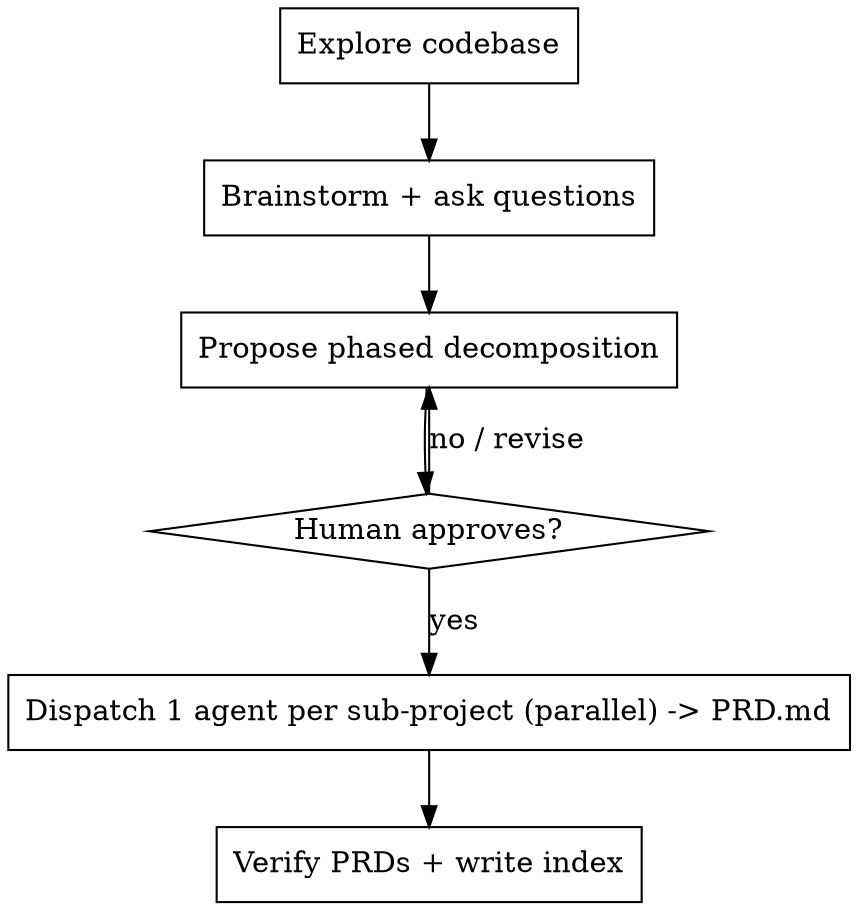

# dev-design — Idea → Sub-Project PRDs

## Overview

Turn a big, messy idea into **sub-projects**, each captured as a tight `PRD.md` (PM spec +
architecture doc, aim ~800–1,500 words). Core principle: **understand and challenge before
you split; split before you write; let parallel sub-agents write — tight on the first
draft.**
Design only — PRDs carry Open Questions, not tasks; `dev-tasks` derives tasks later from
the *approved* PRD so it can be revised without rotting a tasks file.

Shared dispatch/output conventions for this whole pipeline live in
`../_shared/dev-common.md` — read it once; this file only covers what's unique to PRDs.

## When to Use

- Human pastes a proposal / list of improvements / refactor brief and wants it planned.
- Work spans multiple subsystems or many independent changes.
- The ask is "design this", "break this down", "create PRDs".
- **Not for:** a single well-scoped change (plan it directly); generating tasks from an
  existing PRD (`dev-tasks`); writing code (planning only).

## Workflow



1. **Workspace guard.** Apply `../_shared/dev-common.md`'s workspace guard before anything
   else — non-default branch, inside a linked worktree, creating one if not.
2. **Invoke `superpowers:brainstorming` first.** Explore context → ask one at a time →
   present design → get approval.
3. **Explore the codebase before asking anything.** Read real files. Verify the proposal
   against the code — surface dead code, contradictions, stale assumptions.
4. **Ask + challenge.** One at a time where possible; batch only the blocking,
   decomposition-changing decisions with `AskUserQuestion` (≤4/call, recommended option
   first). Challenge over-engineering. Park non-blocking unknowns for each PRD's Risks /
   Open Questions — don't ask them now.
5. **Propose a phased decomposition and get approval.** Each sub-project = one coherent
   chunk with scope, dependencies, a phase. Show a dependency graph. Do not dispatch until
   the human says go.
6. **Dispatch one PRD-authoring agent per sub-project, in parallel** — dispatch rules in
   `../_shared/dev-common.md`. Use `design-agent-prompt-template.md`. Agents write
   `PRD.md` only, tight on the first draft — no TASKS.md.
7. **Verify + index.** Confirm each `PRD.md` exists. Write `README.md` in the branch
   folder: sub-project table, dependency graph, locked decisions, consolidated
   cross-cutting Risks / Open Questions.
8. **Hand off.** Human reviews PRDs, resolves/triages Open Questions *in the PRD*
   (`[RESOLVED: …]` or `[DEFERRED]`), then runs `dev-tasks`. Don't generate tasks here.

## Output Convention

Path grammar in `../_shared/dev-common.md` (find/create the branch folder first):
```
docs/agent_files/<branch-slug>-<YYYYMMDD-HHMM>/<NN-kebab-name>/PRD.md
docs/agent_files/<branch-slug>-<YYYYMMDD-HHMM>/README.md   # index, written last
```

## PRD.md format

Length: aim for **~800–1,500 words** (soft target — going over is fine; never trim after
writing). Full annotated skeleton + frontmatter is in `design-agent-prompt-template.md`;
shape:

```
frontmatter(status/summary/date) → TL;DR → Problem → Goals/Non-Goals → Requirements →
Architecture (high-level; tiny snippet only if essential, never full code) →
Decisions (# | Decision | Choice | Alternatives considered | Why) → Manual steps →
Risks / Open Questions ([OPEN]/[RESOLVED: …]/[DEFERRED] — the dev-tasks gate) →
Acceptance Criteria
```

## Common Mistakes

- **Generating tasks here.** Stop at PRDs; `dev-tasks` owns task files.
- **Dispatching before approval.** Get the decomposition signed off first.
- **Full code in the PRD.** Architecture states the interface/contract delta, not a
  component's full body — that belongs to `TASKS.md`/the implementation.
- **Thin agent prompts.** Cold agents need full context — see `../_shared/dev-common.md`.
- **No status tag on a Risk/Open Question.** Without `[OPEN]/[RESOLVED]/[DEFERRED]`,
  `dev-tasks` can't tell a settled PRD from an unsettled one.
- **No index.** Without the README, cross-cutting decisions stay scattered.
