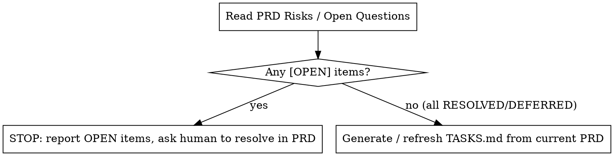

# dev-tasks — Approved PRD → TASKS.md

## Overview

Generate each sub-project's `TASKS.md` as a **pure projection of its PRD**: a tracking
table plus a short, high-level spec per task — no code, no exhaustive file lists. Core
principle: **the PRD is the single source of truth; tasks are regenerated from it, never
hand-edited to chase a PRD change**, and the one exception is the tracking table's
**Status** column, which is never regenerated — see below.

Shared dispatch/output conventions live in `../_shared/dev-common.md`.

## When to Use

- A PRD exists (typically from `dev-design`) and you need its tasks.
- A PRD changed and its `TASKS.md` needs refreshing.
- The ask is "generate tasks", "break the PRD into tasks", "update the tasks".
- **Not for:** designing/decomposing an idea (`dev-design`); writing code.

## The Gate: only build tasks from a settled PRD

A PRD's `## Risks / Open Questions` section is the contract. Before generating tasks,
check it:



**Do not invent answers to `[OPEN]` items to unblock yourself.** Route them back to the
human to record as `[RESOLVED: …]` or `[DEFERRED]` *in the PRD*; tasks then regenerate
deterministically.

## Workflow

1. **Workspace guard.** Apply `../_shared/dev-common.md`'s workspace guard before anything
   else — non-default branch, inside a linked worktree, creating one if not.
2. **Locate the PRD(s).** From the human's pointer — a sub-project folder, a branch
   folder, or an explicit path. Confirm the set before proceeding.
3. **Check the gate (per PRD).** Any `[OPEN]` item → STOP for that PRD, list them, ask the
   human to resolve in the PRD. Proceed only for settled PRDs.
4. **Generate or refresh, per PRD.** Dispatch one `Agent` (general-purpose) per settled
   PRD, in parallel, using `tasks-agent-prompt-template.md`. Each agent reads the whole
   PRD (esp. Architecture, Decisions, Risks / Open Questions) and:
   - No `TASKS.md` exists → author it fresh, every task `Status: todo`.
   - `TASKS.md` exists → **reconcile**: add/modify/remove only tasks affected by what
     changed in the PRD; **preserve the `Status` value of every task that still exists**,
     even if its description text changes; report a short diff. Never blind-overwrite.
5. **Verify + report.** Confirm each `TASKS.md` exists; relay each agent's change summary.

## Output Convention

```
docs/agent_files/<branch-slug>-<YYYYMMDD-HHMM>/<NN-kebab-name>/TASKS.md   (sibling of PRD.md)
```

## TASKS.md format

Length: aim for **~60–150 words per task** (soft target — going over is fine; never trim
after writing). No code, no exhaustive file list — that's for the coding agent to find via
the PRD + its own exploration (see `dev-code`).

```markdown
---
status: draft
summary: <one line>
date: <YYYY-MM-DD>
---
# Tasks: <title>
Source of truth: <PRD path>. <1–3 sentences.>

| # | Task | Depends on | Status |
|---|---|---|---|
| 1 | <short name> | none | todo |
| 2 | <short name> | 1 | todo |

## Task 1 — <short name>
What it is / what it means: <1–2 sentences>.
What changes at a high level: <components/areas/behaviors touched — not a file list>.
Done when: <observable, checkable acceptance criteria>.

## Task 2 — <short name>
...
```

## Keeping PRD ↔ tasks in sync

Resolved an Open Question? Record it in the PRD as `[RESOLVED: …]`, then **re-run
`dev-tasks`** — don't hand-edit `TASKS.md`. Task descriptions are disposable/regenerable
from the PRD; Status is the one exception (operational state, not design projection) and
survives every regeneration. Re-runs reconcile and report a diff.

## Common Mistakes

- **Generating tasks past the gate.** `[OPEN]` items block; route them back, don't guess.
- **Blind overwrite, or losing Status, on reconcile.** Preserve unaffected tasks and Status.
- **Adding scope.** Tasks only implement what the PRD decides.
- **Code or an exhaustive file list in a task.** That's `dev-code`'s job at implementation
  time, grounded in the PRD + its own repo exploration.
- **Setting Status to anything but `todo` here.** Only `dev-code` moves it further.
- **Designing here.** No decomposition or new architecture — that's `dev-design`.
