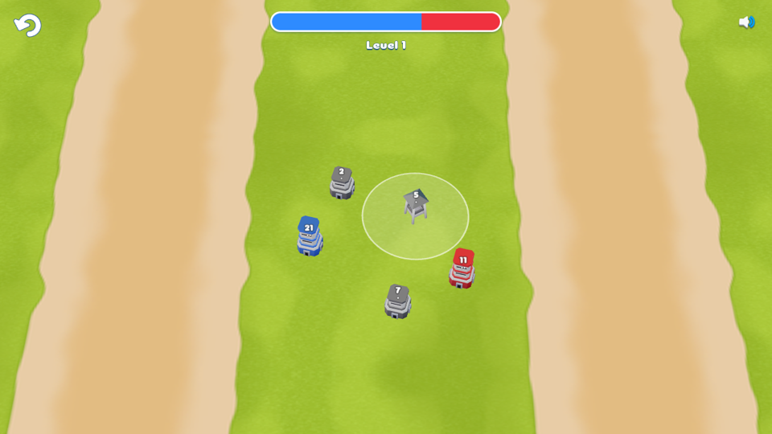
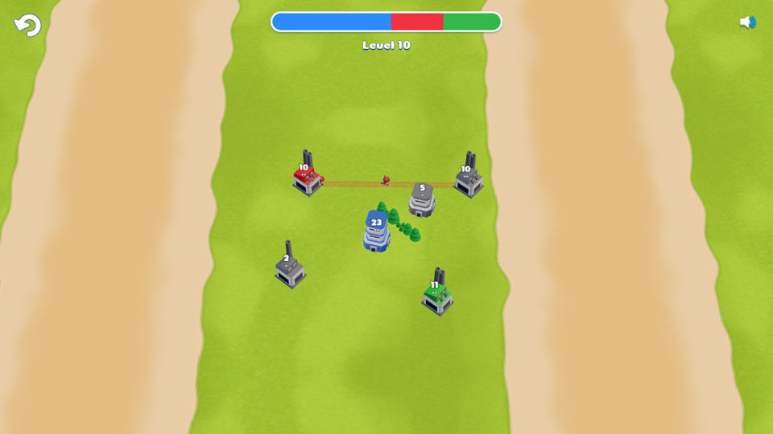
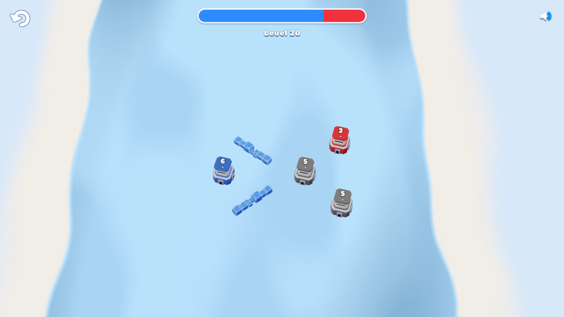

# Node Arena

Browser tower-strategy game: draw persistent routes, capture buildings and complete a 20-level solo campaign. Landscape client with Green and Snow themes, soldiers, tanks, towers, obstacles and scripted AI.

> Assets based on / motivated by Tower War. See [credits](docs/CREDITS.md).

## Contents

- `packages/defs/` — pure registries for modules, bot kinds, commands, objectives, events and phases.
- `packages/content/` — browser-safe schemas, validation, compilation, content data and hash locks.
- `packages/sim/` — deterministic integer simulation, replay playback, goldens and benchmarks.
- `packages/bots/` — default/scripted AI and human proxy.
- `packages/net/` — transport-free multiplayer protocol, session and lockstep core.
- `apps/server/` — PvP game server (`@node-arena/server`, Node + ws).
- `apps/web/` — Vite + Preact + Three.js client, local progress/audio settings and browser tests.
- `tools/` — importers, asset pipeline, gates, level determinism and balance reports; [commands and gate semantics](tools/README.md).
- `docs/GAME_RULES.md` — mechanics contract, stable rule IDs and version history.
- `docs/CONTENT_GUIDE.md` / `docs/LEVELS_GUIDE.md` — authoring, import policy, versions and feature coverage.
- `docs/research/` — teardown evidence and historical research; `docs/agent_files/` — approved designs/tasks and run records.
- `docs/FUTURES.md` — deferred features.
- `docs/PVP_OPS.md` — owner runbook for the PvP server on Fly.io (deploy, rollback, health, heartbeat check).

The shipped campaign is the Common list's positions **4–23** (tutorial positions 1–3 omitted), shown as levels 1–20 in the client. `packages/content/data/campaigns/common.json` is authoritative. Cargo and tutorial scripts are dropped; position 23 also drops one wall. These are documented fidelity limits in the levels guide. Online PvP supports human and bot seats, teams and spectators; later campaign positions remain deferred.

## Screenshots

Actual client captures from the campaign browser verification, resized to 960px wide for this README.

| Level 1 · Green | Level 10 · Green | Level 20 · Snow |
|---|---|---|
|  |  |  |

## Development

Requires Node >=22.13 and pnpm 10.34.6 (pinned by the package manager field). Run from the repository root.

```sh
pnpm install --frozen-lockfile
pnpm build:prerequisites
pnpm --filter @node-arena/web exec playwright install --with-deps chromium
pnpm dev
```

Chromium is also needed by content/sim browser parity checks; install it with the same workspace command for those packages if their Playwright versions differ. CI installs all three.

| Command | Purpose |
|---|---|
| `pnpm build` | Build all workspaces and production client |
| `pnpm test` | Workspace tests |
| `pnpm lint` / `pnpm typecheck` | Static checks |
| `pnpm run ci` | Named gate chain, including browser parity; [baseline and parking](tools/README.md#ci-and-version-baselines) |
| `pnpm test:web:e2e` / `pnpm test:web:all` | Test-build browser suite / preview + development suites |
| `pnpm campaign:verify` | Opt-in 20-level browser smoke and captures in the generated directory test-results/campaign/ |
| `pnpm validate:levels` / `pnpm levels:lock` | Check / regenerate seed-1 campaign determinism lock |
| `pnpm check:docs` / `pnpm check:parked --strict` | Documentation consistency / closing parked-gate check |

Committed levels and assets work without the original extract. Set `TW_EXTRACT` to the Tower War extract directory for `pnpm import:tw`, `pnpm check:import`, `pnpm assets:tw` and `pnpm assets:tw:check`. Without it, import writes fail with an explanation; import verification and art regeneration/checks skip. CI never downloads the extract; `pnpm check:manifest` still checks committed asset hashes, budgets and credits. See the [levels guide](docs/LEVELS_GUIDE.md) and [tools guide](tools/README.md) before regenerating data.

## Play online (PvP)

For local play, complete the Development prerequisites above (including `pnpm build:prerequisites`, which builds net), then run:

```sh
pnpm dev:pvp
```

The command works in Windows Command Prompt/PowerShell, macOS and Linux. Keep the process running: web uses port 5173, server uses 8080. Existing `PORT` and `ALLOWED_ORIGINS` environment values override the server defaults. Plain `pnpm dev` runs only the web client.

1. Tab A: open <http://127.0.0.1:5173/>, select **Play online**, enter a nickname, then **Create room**. The default map is **Duel S**; the host can select **Duel M** or **Cross** and edit seat types, bot difficulty and teams. For a two-human Duel S match, leave both seats Human on opposing teams.
2. Use **Copy play link**, or note the four-character **Room code** and replace XXXX in `http://127.0.0.1:5173/?room=XXXX`.
3. Open a genuinely fresh tab with your browser's New Tab command, then paste that URL into its address bar. Use the same browser profile if desired. Avoid Duplicate Tab or opening from a tab that copies its session storage: each player needs a distinct per-tab token.
4. Tab B: a saved nickname joins automatically. A new visitor sees the nickname field and prefilled room code: enter a nickname, then **Join**. You may use a separate browser profile for a different saved nickname.
5. Tab B: press **Ready**. Tab A: press **Start** (the host is already ready). After the countdown, draw routes from your buildings to capture the opponent's buildings. Keep both tabs visible in separate windows for the play-test; background tabs may throttle rendering.
6. Finish the match and confirm both tabs show the corresponding Victory!/Defeat result (or Draw on both tabs). **Rematch** returns everyone to the lobby; ready up and start again. **Leave** returns to **Play online**. During a match, a seated player uses **Esc** → **Leave** → **Yes** to forfeit.
7. **Pause** (top bar) freezes the match for both players and shows each hold's countdown; **Resume** continues. Each player has one 30 s budget, cumulative across pauses and disconnects (RULES 3.2.0, protocol v2). A closed, reloaded or dropped tab opens a disconnect hold on the remaining budget (detected within about 8 s); returning before it expires catches up and resumes, otherwise that seat forfeits. Pause/disconnect holds have no budget expiry in matches with one human and only bots. Manual post-deploy heartbeat check: [docs/PVP_OPS.md](docs/PVP_OPS.md#heartbeat-check-through-the-fly-edge-manual-once-after-first-deploy).

To spectate, use **Copy watch link**, append `&watch` to a play link (for example `http://127.0.0.1:5173/?room=XXXX&watch`), or enter a room code and select **Watch**. Spectators can join an ongoing match and see its result. For a solo bot match, set the other seat to **Bot**, choose its difficulty, then **Start**. On Cross, set four occupied human/bot seats and their teams for a team match.

Tokens live in per-tab `sessionStorage`; nicknames are shared through `localStorage`. M1 local human play-test is approved. M2 production play-test and final approval remain pending.

Production client: <https://node-arena-99.web.app>. The configured PvP endpoint is `wss://node-arena-server.fly.dev`; the first Fly deployment and production connection checks have **not** been performed. Once deployed, production play/watch links use the same query parameters on that client URL. Previews use the production server: a version mismatch offers **Reload**, then disables online play if the build still differs; single-player remains available.

Run `pnpm test:pvp:e2e` for the separate Chromium suite: Duel S, watch/rematch, bot seats, Cross teams, pause/reconnect/forfeit and version mismatch. See [server instructions](apps/server/README.md) for server-only development and [operations](docs/PVP_OPS.md) for deployment.

## Deploy / hosting

Static client on Firebase Hosting (project `node-arena-99`): <https://node-arena-99.web.app>. `firebase.json` serves `apps/web/dist` with an SPA rewrite.

- Pushes to `main` run `.github/workflows/deploy.yml` (live deploy).
- Same-repo PRs get a preview channel `pr-<N>` (7-day expiry) via `.github/workflows/preview.yml`; the URL is commented on the PR and the channel is deleted when the PR closes.
- Both need the repo secret `FIREBASE_SERVICE_ACCOUNT` (JSON key of `github-deployer@node-arena-99.iam.gserviceaccount.com`, roles Firebase Hosting Admin + Service Usage Consumer).
- Manual web deploy (needs `firebase login`; set `VITE_PVP_SERVER_URL=wss://node-arena-server.fly.dev` in the build environment to include PvP): `pnpm build:prerequisites && pnpm build:web && npx firebase-tools@15.34.1 deploy --only hosting --project node-arena-99`.

PvP server: Fly app **node-arena-server**, configured by `apps/server/fly.toml` and `apps/server/Dockerfile`. The deploy graph is **changes → server → web**: server-affecting changes deploy to Fly and check health endpoint versions before Firebase deploys; web-only changes skip the server job. A failed server deploy or versions check blocks the web job. Manual dispatch of **Deploy** includes the server; **Deploy server** runs the server workflow alone.

The server workflow needs repo secret **FLY_API_TOKEN** (app-scoped deploy token). Both web workflows inject repo variable **PVP_SERVER_URL** as **VITE_PVP_SERVER_URL**, falling back to `wss://node-arena-server.fly.dev`; production and preview origins are listed in the Fly config. Rooms live in one server process and are lost on deploy/restart. The owner reports Fly account/app/setup complete; first deployment, live health/version smoke, production/preview connections and the Fly-edge heartbeat check remain unverified. Follow the [first-deploy checklist](docs/PVP_OPS.md#first-deploy-checklist).
