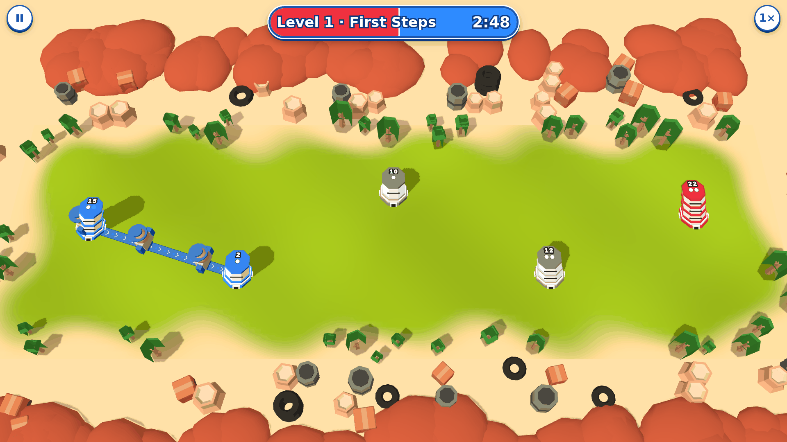
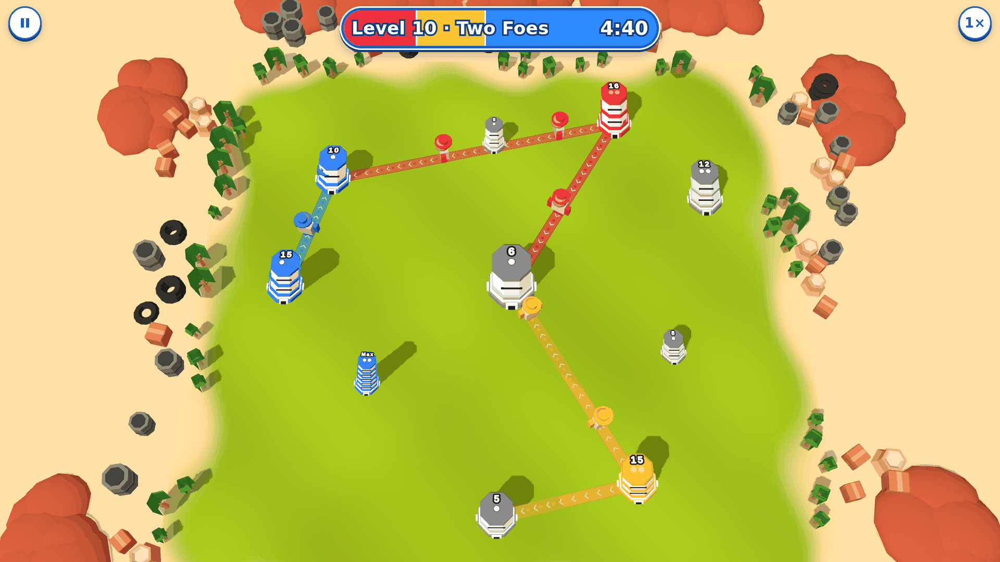
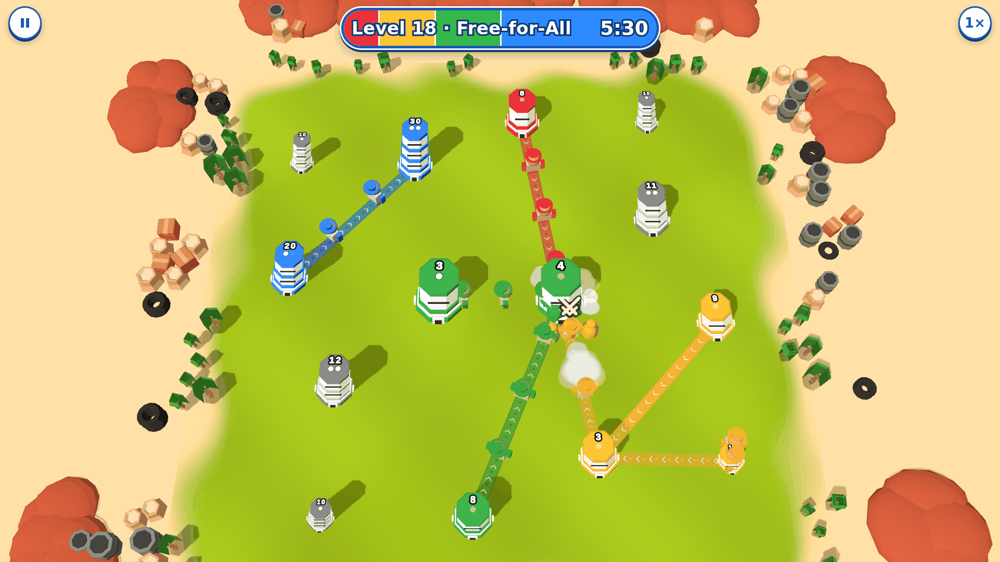

# Node Arena

Ad-free browser strategy game (persistent-route tower war) with solo campaign and private multiplayer with friends. Design in progress.

## Contents
- `research/engine-research.md` — engine/stack comparison
- `research/similar-games.md` — survey of existing similar games
- `docs/agent_files/` — design docs (brainstorm, PRDs, tasks)

- `packages/content/` — browser-safe content schemas and validation (TypeBox + Ajv); generated editor schemas, v1 data, sample level and content hash lock.
- `packages/bots/` — browser/worker-safe bot contracts and guarded player-visible context; shared simulation determinism lint policy.
- `packages/sim/` — deterministic integer-rule engine, component registry, zero-copy views, state hashes, replay helpers, golden parity tests, and performance benchmark.

- `tools/` — Node-only content/version/hash and manifest/asset gates, plus a reproducible worker-thread balance matrix with Markdown/JSON reports.

- `apps/web/` — Vite + Preact + Three.js client scaffold, browser boot smoke tests and SP03 module layout.

## Look
Bright diorama style: a sand/grass island with low-poly props, stacked octagon towers with roof numbers, two-colour lanes with chevrons, chibi troops, and a blue pill HUD (level name, timer, team-strength meter). Deferred ideas (tank factory, watchtower/archer, boosts, themes, SFX) live in `docs/FUTURES.md`.

| Level 1 | Level 10 | Level 18 |
|---|---|---|
|  |  |  |

## Development

Requires Node >=22.13 and pnpm 10.34.6 (`packageManager` pins the version).

```sh
pnpm install --frozen-lockfile
pnpm build:prerequisites # compile package exports before tests on a fresh checkout
pnpm test
pnpm build
pnpm lint
pnpm typecheck     # explicitly check every workspace and TypeScript fixtures
pnpm run ci        # full local/Actions gate chain (Chromium required)
pnpm dev            # start the web client
pnpm test:web:e2e   # production-browser tests (Chromium required)
pnpm test:web:all   # full preview + dev browser suites, sequential/one worker
pnpm content:schemas  # regenerate committed JSON Schema after schema changes
pnpm check:schemas   # fail if generated schemas are stale
pnpm content:lock    # regenerate per-level/per-profile identities
pnpm validate:content --base HEAD  # tools gate: content, sim/bot locks, versions
pnpm check:manifest # content presentation keys, asset safety/budgets/credits
pnpm check:rules    # every active rule has a real test-title coverage tag
pnpm replay:verify golden # play sim/bot golden recordings without bots
pnpm replay:verify path/to/match.replay.json --format json
pnpm balance --levels all --proxy reference,human-proxy,idle --seeds 200 --jobs 2
pnpm balance --mode arena --proxy rusher,turtle --seeds 200 --format json
pnpm check:content --base HEAD  # compare to committed manifest and lock
pnpm sim:golden      # verify committed simulation replays
pnpm bench:sim       # enforce strict simulation performance budgets
pnpm bench:bots      # strict local 1 ms decision budget
pnpm bench:bots --ci # shared-runner 5 ms decision budget
```

The content package exports TypeBox schemas and inferred types for content versions, balance defaults, troops, archetypes, and levels, plus `SCHEMA_VERSION`, `CoreSchemas`, `createAjv`, `validateTroop`, `FIXED_POINT_SCALE`, `convertFixedPoint`, and `loadContent`. `loadContent(fileMap)` accepts JSON strings or objects keyed by source path and returns cloned core entities under the same paths. Only fields tagged `x-unit: fx3` become milli-unit integers; counts and durations remain in authored units. `ContentLoadError.errors` contains source files, JSON pointers, and messages. Component maps accept flat param bags for registry extensibility; the registry and shared semantic validator reject unknown components, unresolved references, invalid inheritance, reserved non-empty arrays, and unsupported parameter patches. Untagged numeric extension params must be integers. Node file access belongs in external adapters or package scripts; all content source files reject imports of fs, path, and crypto.

Hosted contracts include `BotSchema`/`BotProfile`, `ManifestSchema`/`Manifest`, and plain `BotJsonSchema`/`ManifestJsonSchema` exports. `CoreSchemas` includes bot profiles for file-map loading; `HostedSchemas` adds the web-only manifest for editor generation and freshness checking. Every profile requires `kind`; tiers put `extends` inside `params` and may supply only a `skill` block. Reference resolution, kind consistency and inheritance depth are enforced by semantic validation. `bot-params.ts` hosts closed attack/reinforce/cut maps for all ten utility considerations, action biases, hold threshold, target cap, cooldown, and component values keyed by the content registry; SP04 owns bot data and the engine. Optional personality fields preserve minimal profiles; the engine supplies their defaults. Ten consideration weights capped at 10,000 milli keep each weighted scoring numerator at most 100,000,000 (below int32); scoring must normalize this numerator before applying the action bias. Bot decimals tagged fx3 load into milli-units (weights/biases at most 10 authored = 10,000 milli). Manifest values stay in presentation units: hex palette/theme colours, xyz vectors for lights/props, string fx/sfx keys. SP03 owns the manifest file and asset interpretation/validation.

`validateContent(fileMap, { manifest }?)` reports all schema, precision and semantic errors plus located warnings without mutating its input. The optional manifest must satisfy the complete hosted schema; content visuals, themes (including the balance fallback) and color keys in every palette are cross-checked. `loadContent` applies the same validation and throws `ContentLoadError` on any error, even when an entire referenced category is missing. For isolated editor/schema fixtures only, `{ partial: true }` explicitly limits loading to schema, numeric and component-registry checks. `parseContent` exposes the schema/numeric stage; `resolveProfiles` and `resolveLevelOverrides` expose cloned loaded-unit resolution for the compiler. Campaign order checks apply to `data/levels/NN-*.json` files: present orders start at 1 and remain contiguous, capped at 20; sample files can exist before the full campaign. Footprints use authored radii and allow touching; a separate clearance margin requires a future rules/data parameter.

`compileLevel(loadContent(fileMap), levelId)` exports the `CompiledLevel` boundary shared by sim, web and bots. Towers and players use lexical id order; owners are player indices (`-1` for neutral), teams default to their player ids, and `generates.troop` is a dense index into the sorted, referenced-only `kinds` array. Coordinates, footprints, generation rates, troop speeds and bot fx3 params remain loaded milli-unit integers without a second conversion. Level patches resolve on independent clones; time limits and theme keys fall back to balance defaults. Tower visuals/footprints, map bounds, globals and fully inherited bot profiles pass through for downstream consumers. `simHash` is SHA-256 of canonical resolved sim inputs and the per-profile `botHash` map identifies resolved bot profiles separately. Presentation keys, names, bots, unused entities and schema metadata are excluded from sim identity. The package exports `RULES_VERSION`, `ReplayHeader`, pure `sha256`/`canonicalJson`, and `generateHashes`. `check:content` verifies fresh locks, the rules header/export/metadata equality, and an increasing `contentVersion` when level hashes differ from the baseline manifest and lock, even after regenerating the lock. Pass `--base <git-revision>` for branch checks; CI supplies its PR/push baseline with full history. Bot hash version enforcement is deferred to SP04's `BOT_VERSION`.

The v1 dataset starts at content/rules/schema version `1.0.0`: `data/balance.json` supplies the default time limit and theme, `data/troops/regular.json` supplies the troop, and `data/archetypes/{standard,small,large}.json` supplies the base and variants. Variant values are placeholders for SP05 tuning. `data/levels/sample.json` demonstrates one human, one bot and a neutral tower with empty overrides; its filename keeps it outside the reserved campaign `01`–`20` order checks. `data/examples/sample-bot.json` is a minimal idle supporting profile so the sample validates and compiles; SP04 owns production profiles under `data/bots/`, and SP05 owns campaign levels. SP03 owns the asset manifest.

Run `pnpm content:lock` and `pnpm check:content --base 656d0ca` to regenerate and check the complete dataset and non-empty lock. The first dataset can start against a revision before content metadata exists; removing an existing dataset cannot use this exception.

The sim package exposes `create`, `TICK_RATE`, simulation/command/event/view/snapshot types, math/PRNG utilities, component registry helpers, and `createReplayRecorder`/`playReplay`. A simulation provides `step`, `canDraw`, `view`, `readTroops`, `snapshot`, and `hash`. Rule computations use integers; Float64 statistics carry exact safe integers and remain excluded from rule-state hashes.

The CI workflow runs the complete gate chain on Node 22 and 24: lint, compile prerequisites, typecheck, sequential workspace tests, schema freshness, content lock/version checks, content/manifest/rule checks, four-seed level validation, replay verification, simulation and bot goldens, and both performance benchmarks. Compilation precedes tests because workspace package exports point to generated `dist` files. `pnpm run ci` uses the PR base or pre-push commit supplied as `CONTENT_BASE` by Actions. Local runs default to `HEAD^`; a repository's initial commit uses `HEAD` to establish its first baseline. Invalid explicit revisions fail. To choose a local baseline, use `CONTENT_BASE=<revision> pnpm run ci`. The pinned pnpm reserves `pnpm ci` for an unimplemented built-in command, so the script must be invoked as `pnpm run ci`.

Install Chromium once before local CI using `pnpm --filter @node-arena/web exec playwright install --with-deps chromium`, and repeat for `@node-arena/content` and `@node-arena/sim` if their Playwright versions differ. Actions installs all three to cover parity consumers independently. A separate Actions job runs the full SP03 preview and development browser suites sequentially with one worker.

The balance workflow runs nightly at 03:00 UTC or manually, with 200 seeds and two workers, and uploads both Markdown and JSON reports. Statistical flags remain informational and are outside PR gates. GitHub Actions must be enabled on the repository by its owner; no secrets are required.
