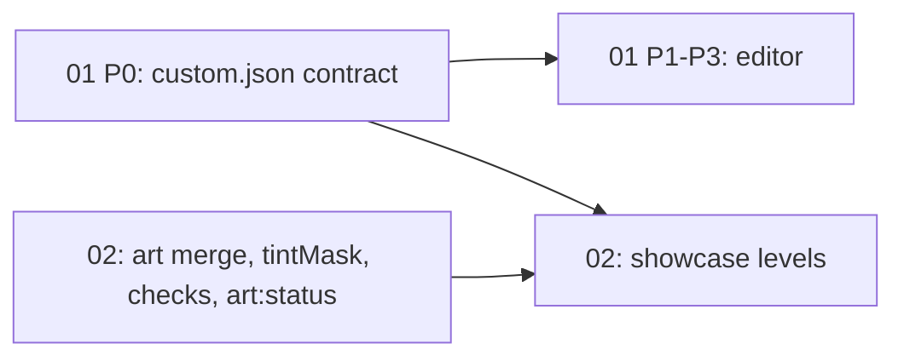

# Level editor + art overrides (docs/kane-cli-and-agent-files-consolidation)

## Goal
Two dev-only tools: in-app level editor and art-override layer. Design only.

## Contents
| File | Purpose | Status |
|---|---|---|
| [brainstorm.md](brainstorm.md) | Decision log + design brief for both projects | draft |
| [01-level-editor/PRD.md](01-level-editor/PRD.md) | Dev-only editor.html, `/__editor/*` middleware, Play/Solvable?/Finalize, custom-level list | draft |
| [02-art-overrides/PRD.md](02-art-overrides/PRD.md) | `assets/art/` override layer, tintMask, relaxed credits check, `art:status`, showcase levels | draft |

## Sub-projects
| # | Name | Scope | Depends on | Phase |
|---|---|---|---|---|
| 01 | Level editor | editor.html + dev middleware + custom list + Finalize | none | P0 custom-list contract, P1 viewer+save, P2 editing, P3 play/solvable/finalize |
| 02 | Art overrides | art folder/manifest merge, tintMask, checks, `art:status`, 2 showcase levels | 01 P0 (custom-list contract) for showcase levels only; rest independent, parallel | single PRD, no phases defined |

## Dependency graph

## Locked decisions
See [brainstorm.md decision log](brainstorm.md#decision-log); not duplicated.
- Own editor in `apps/web/editor.html`, Vite dev middleware for fs, dev-only (level editor table).
- v1 = layout + player/AI settings + in-editor Play; Solvable? and Finalize are separate buttons.
- Tools never `git commit`; owner commits.
- Custom levels in separate list (`campaigns/custom.json`), below the 20, always unlocked.
- Art lives in `apps/web/assets/art/`, ignored by importer/lock; `manifest.art.json` merged after TW fragment (art overrides table).
- Field-level overrides, replace existing visuals only; stale override target fails loudly.
- Team colour: 5-skin swap or 1-skin + tintMask.
- CREDITS.md check becomes warning; game-compat checks (budgets, stage nodes) stay.
- No preview page: two showcase levels (green, snow) instead; reload to see changes.

## Shared seams
- `custom.json` / custom-list contract (01 R6, 01 P0)
- `campaignLevels()` union (Common + custom)
- `hashes.lock.json` + `contentVersion` + `BOT_VERSION`
- `levels-lock.json`
- `tools/unsolved-by-proxy.json`
- 20-level test exclusions (tests selecting levels must not sweep custom)
- `tools/README.md` (document new commands/gates)

## Cross-cutting Open Questions
a) [OPEN] Do `validate:levels` / `levels:lock` cover custom `na-*` levels? `tools/src/levels.ts` uses `campaignLevels(data)` (Common-only today); the two PRDs read this differently. Decide during dev-tasks for 01 P0.
b) [OPEN] `tools/unsolved-by-proxy.json` schema requires integer `position` (`tools/src/unsolved.ts:8`); custom levels have none. Needs schema decision (shared 01/02).
c) [RESOLVED] `BOT_VERSION` bump required for new levels with AI seats (CONTENT_GUIDE). 01 R5 wording updated.
d) Remaining per-PRD [OPEN] items:
   - [01 Open Questions](01-level-editor/PRD.md#open-questions): `levels:lock` full run vs `--levels <id>` merge; Play cost of full `loadContent`; grid snap default/yaw; `custom.json` `position` for new levels; `levels:lock` position arg for custom levels.
   - [02 Risks/Open Questions](02-art-overrides/PRD.md#open-questions): unsolved `position` (= b); validate:levels glob (= a); sfx map ownership vs manifest-fragment; stage depends only on level?; `assets:tw` cleanup only touches OWNED dirs?; per-visual `tintStrength`; `gray` for non-neutral units.

## Next step
Owner reviews PRDs, tags Open Questions [RESOLVED]/[DEFERRED] in each PRD, then run dev-tasks per PRD.
