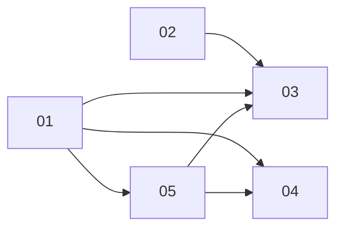

# Editor chrome polish

Brief: `brainstorm.md`. Screenshots: `before/` (current editor, 9 shots), `ref/` (`canva.png` Share panel, `gmaps.png` map controls).

## Sub-projects
| # | Name | Scope | Depends | Status |
|---|---|---|---|---|
| 01 | theme-tokens | `--ed-*` tokens, Inter/system stack, base button/input/menu/popover/modal/toast styles | none | draft |
| 02 | versioning-save | `editorVersion` 0.0.N, 30s autosave, Finalize saves first, server Duplicate op | none | draft |
| 03 | topbar-menus | Back + File menu, dialogs, Share panel, Check flow, save status | 01, 02, 05 | draft |
| 04 | left-panel | Read-only level id, param labels/tooltips, read-only troop | 01 | draft |
| 05 | map-controls | Vertical map-style canvas controls | 01 | draft |

## Dependency graph

Recommended landing order: 01, 02, 05, 04, 03 (single shared `style.css`; 01 first).

## Locked decisions
Base origin/main (#24 merged). Back + File top-left (Create/Duplicate/Open/Undo/Redo). Canva-style Share panel top-right (Save, Finalize without gate and saving first, Check with spinner/toast/results popover, nothing persisted). Plain "✓ Saved" status. Play kept. `editorVersion` 0.0.N per real save, no-op when unchanged, new/copies 0.0.1, missing 0.0.0; autosave 30s; no schemaVersion bump. Back confirms if unsaved; Duplicate-when-dirty = Save & duplicate / Cancel. Neutral theme, no webfont, accent `#2563c9` tuned in review, 56px bar. Details in `brainstorm.md`.

## z / gutter contract
- `--ed-controls-gutter: 56px` (12 inset + 36 card + 8 gap), defined in SP01 tokens.
- Map controls `z-index: 3`.
- Popovers, Share panel, Check flyout: `z-index: var(--ed-z-pop)` (5). Toasts 15, modals 20.
- Right-anchored panels keep `right >= var(--ed-controls-gutter)` so the column stays visible.

## Remaining cross-cutting risks / open questions
- Open: SP01 `.canvas-controls` block in `style.css` shared with SP05; SP01 only swaps tokens, SP05 rewrites (order 01 -> 05).
- Open: SP05 assumes SP01 tokens (`--ed-sh-md`, `--ed-r-lg`, `--ed-accent-soft`, `--ed-g-*`) exist; SP05 task must follow SP01.
- Verify (SP02 task): content gates (`check:content`, `validate:content --base HEAD`, `tools/test/gates.test.ts`) vs level file change with unchanged simHash; exempt editorVersion if flagged.
- Verify (SP04): tooltip wording vs R-TWR-01 / GAME_RULES.
- Risk: one shared CSS file across 5 sub-projects; large e2e churn (shared helper `apps/web/e2e/editor-helpers.ts`).
- Deferred: self-hosted Inter, dark mode, arrow-key nav in Share panel, map-control extras (minimap, tooltips with shortcuts).

## Folder contents
- `brainstorm.md`, `README.md`
- `01-theme-tokens/` ... `05-map-controls/` (each `PRD.md`)
- `before/` current-editor screenshots; `ref/` reference screenshots
