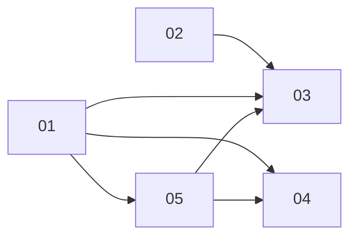

# Editor chrome polish

Brief: `brainstorm.md`. Screenshots: `before/` (current editor, 9 shots), `ref/` (`canva.png` Share panel, `gmaps.png` map controls).

## Sub-projects
| # | Name | Scope | Depends | Status |
|---|---|---|---|---|
| 01 | theme-tokens | `--ed-*` tokens, Inter/system stack, base button/input/menu/popover/modal/toast styles | none | done |
| 02 | versioning-save | `editorVersion` 0.0.N, 30s autosave, Finalize saves first, server Duplicate op | none | done |
| 03 | topbar-menus | Back + File menu, dialogs, Share panel, Check flow, save status | 01, 02, 05 | done |
| 04 | left-panel | Read-only level id, param labels/tooltips, read-only troop | 01 | done |
| 05 | map-controls | Vertical map-style canvas controls | 01 | done |
| 06 | editor-amendments | Menu Create reuse, no Apply buttons, Add AI recolour, player-needs-house Check, toolbar tweaks, hide 3 params, grey thumbnails, row obstacles, double-click place | 03, 04 + review fixes | done |

## Dependency graph

Recommended landing order: 01, 02, 05, 04, 03 (single shared `style.css`; 01 first).

## Locked decisions
Base origin/main (#24 merged). Back + File top-left (Create/Duplicate/Open/Undo/Redo). Canva-style Share panel top-right (Save, Finalize without gate and saving first, Check with spinner/toast/results popover, nothing persisted). Plain "✓ Saved" status. Play kept. `editorVersion` 0.0.N per real save, no-op when unchanged, new/copies 0.0.1, missing 0.0.0; autosave 30s; no schemaVersion bump. Back confirms if unsaved; Duplicate-when-dirty = Save & duplicate / Cancel. Neutral theme, no webfont, accent `#2563c9` tuned in review, 56px bar. Details in `brainstorm.md`.

## z / gutter contract
- `--ed-controls-gutter: 56px` (12 inset + 36 card + 8 gap), defined in SP01 tokens.
- Map controls `z-index: 3`.
- Popovers, Share panel, Check flyout: `z-index: var(--ed-z-pop)` (5). Toasts 15, modals 20.
- Right-anchored panels keep `right >= var(--ed-controls-gutter)` so the column stays visible.

## Cross-cutting verification and deferred work
- Resolved: SP01 tokens landed before SP05 control CSS rewrite; required shared-file order completed.
- Verified: SP05 uses the completed SP01 token contract (`--ed-sh-md`, `--ed-r-lg`, `--ed-accent-soft`, `--ed-g-*`).
- Verified: SP02 editorVersion metadata and unchanged simHash pass content/version guards; final live CI gates pass.
- Verified: SP04 tooltips match R-TWR-01/GAME_RULES; factual timing descriptions corrected without mechanics changes.
- Verified: shared CSS sequence and atomic SP03 helper/selector migration completed; fresh editor dev/preview and full live CI pass.
- Verified: SP03 Task 9 live geometry, stacking and screenshots close SP05 Share/Check gutter integration.
- Deferred: self-hosted Inter, dark mode, arrow-key nav in Share panel, map-control extras (minimap, tooltips with shortcuts).

## Folder contents
- `brainstorm.md`, `README.md`
- `01-theme-tokens/` ... `06-editor-amendments/` (each `PRD.md`)
- `before/` current-editor screenshots; `ref/` reference screenshots

## SP01 implementation and review artifacts
- [Implementation run (all six tasks)](01-theme-tokens/code-20261026-1714.md)
- [Legacy cleanup proof](01-theme-tokens/code-20261026-1655.md)
- [Verification, contrast and captures](01-theme-tokens/code-20261026-1705.md)
- [Initial review — NEEDS_CHANGES, one stacking fix](01-theme-tokens/review-2026-10-26-1714.md)
- [Verification results](01-theme-tokens/verification-results.json), [browser harness](01-theme-tokens/verify-theme.mjs)
- [SP01 screenshots and protected baselines](01-theme-tokens/screens/), [nine after states and additional captures](after/)

SP01's six planned tasks and stacking review fix are complete; all three final reviewers PASS.

- [Final SP01 review — PASS](01-theme-tokens/review-2026-10-26-1718.md)

## SP02 implementation artifacts
- [Implementation run (all six tasks)](02-versioning-save/code-2026-10-26-1745.md)
- [Save-first Finalize and full final verification](02-versioning-save/code-2026-10-26-1743.md)

SP02's six tasks are complete; Bug Hunter, Security and Architect PASS.

- [Final SP02 review — PASS](02-versioning-save/review-2026-10-26-1746.md)

## SP05 implementation artifacts
- [Implementation run (all four tasks)](05-map-controls/code-2026-10-26-1759.md)
- [Layout regression, captures and final verification](05-map-controls/code-2026-10-26-1755.md)
- [Eleven screenshots](05-map-controls/screens/), [browser harness](05-map-controls/verify-controls.mjs), [machine results](05-map-controls/verification-results.json)

SP05's four tasks are complete; Bug Hunter, Security and Architect PASS. SP03 Task 9 now closes the cross-cutting Share/Check gutter integration through actual geometry assertions and captures.

- [Final SP05 review — PASS](05-map-controls/review-2026-10-26-1759.md)

## SP04 implementation artifacts
- [Implementation run (all five tasks)](04-left-panel/code-2026-10-26-1829.md)
- [Styling, captures and full verification](04-left-panel/code-2026-10-26-1818.md)
- [Three screenshots](04-left-panel/screens/), [browser harness](04-left-panel/verify-left-panel.mjs), [machine results](04-left-panel/verification-results.json)

SP04's five tasks are complete; Bug Hunter, Security and Architect PASS.

- [Final SP04 review — PASS](04-left-panel/review-2026-10-26-1829.md)

## SP03 implementation staging
- [Staging and initial task dispatch](03-topbar-menus/code-2026-10-26-1830.md)

Tasks 1–7 built props-driven component foundations; Task 8 integrated new chrome, removed legacy surfaces and migrated selectors atomically.

## SP03 implementation and review history
- [Implementation run (all nine tasks and stale-Open fix)](03-topbar-menus/code-2026-10-26-1903.md)
- [Early Bug Hunter finding and resolution history](03-topbar-menus/review-2026-10-26-1903.md)

SP03 all nine tasks complete; final Bug Hunter, Security and Architect reviews PASS. Early stale same-id Open was fixed and regression verified.

- [Task 9 full CI, live geometry and visual verification](03-topbar-menus/code-2026-10-26-1917.md)
- [Eight final screenshots](03-topbar-menus/screens/), [capture harness](03-topbar-menus/verify-chrome.mjs), [machine results](03-topbar-menus/verification-results.json)

Final verification: 67 dev editor passes/two expected preview skips, both preview cases passed separately; all live CI gates pass, 983 unit/fixture passes, 19 extract-only cases skipped and two extract gates skipped (`TW_EXTRACT` absent). Original-extract checks remain unverified; `PARKED` empty.

- [Final SP03 review — PASS](03-topbar-menus/review-2026-10-26-1919.md)
- [Final branch run — all five sub-projects](code-2026-10-26-1919.md)

All five sub-projects complete in order 01 → 02 → 05 → 04 → 03; all final independent reviews PASS.

## Whole-branch deep review (2026-10-26)
- [Whole-branch deep review — NEEDS_CHANGES](review-2026-10-26-2000.md)
- [Re-review of whole-branch fixes — PASS](review-2026-10-26-2100.md)

## SP06 implementation and verification
[PRD](06-editor-amendments/PRD.md), [TASKS](06-editor-amendments/TASKS.md). Owner amendments after SP01-05: game-menu Create reuses the editor Create dialog; live-applied edits with undo coalescing (no Apply buttons); Add AI recolours a neutral house; Check/Finalize require every player to own a house; Save/icon Play/Share toolbar; three params hidden; grey thumbnails; multi-tile "row" obstacle (one element, existing footprint override, no schema change); double-click placement. All ten tasks complete after the whole-branch review fixes. Root typecheck/lint/test/content gates pass; final preview 24 passed / 77 expected dev-only skips; final development 99 passed / 2 expected preview-only skips. Unit/fixture suite: 1,011 passed, 19 extract-only skips.

- [SP06 implementation run — all ten tasks](06-editor-amendments/code-2026-10-26-2314.md)
- [Independent SP06 production review — PASS](06-editor-amendments/review-2026-10-26-2235.md)
- [Five accepted screenshots](06-editor-amendments/screens/), [machine verification results](06-editor-amendments/verification-results.json)
