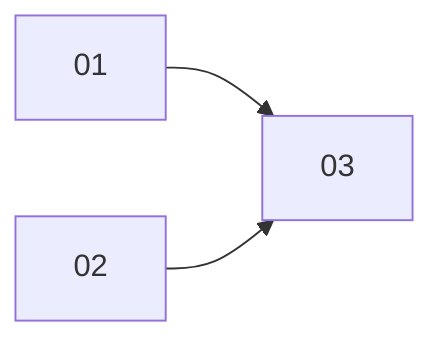

# Menu + online flow: PRD index
Branch `feat/menu-online-flow` (worktree `.worktrees/feat/menu-online-flow`). Design only; tasks not yet generated (dev-tasks).

## Sub-projects
| NN | Title | Scope | Depends on | PRD |
|---|---|---|---|---|
| 01 | Menu layout + thumbnails | Stacked full-width menu tiles, Custom DEV-only, custom thumbnails, shared `LevelThumbnailService` | none | [01-menu-layout](01-menu-layout/PRD.md) |
| 02 | Dynamic seats | Maps playable by 2..max players; neutral unused slots; RULES 3.3.0; PROTOCOL 4; server range validation | none | [02-dynamic-seats](02-dynamic-seats/PRD.md) |
| 03 | Online flow | Create/Join screens, Participant/Spectate forms, live host room form, nickname persistence | 01, 02 | [03-online-flow](03-online-flow/PRD.md) |

## Dependency graph

01 and 02 touch disjoint files and may run in parallel; 03 starts after both.

## Locked decisions
- Menu: three stacked full-width rectangles; Custom hidden unless `import.meta.env.DEV`; custom cards show thumbnail only (name in aria-label).
- Thumbnails: live offscreen WebGL render of the compiled level, in-memory cache, sequential queue.
- Seats: map max = `players.length`; match uses first n slots in `players[]` order; unused slots' buildings -> neutral (authored level); no level-schema change; cross reordered so prefixes are fair.
- Versions: RULES 3.2.0 -> 3.3.0 (minor), PROTOCOL 3 -> 4, contentVersion bump; SCHEMA unchanged; BOT_VERSION 2.5.0 -> 2.5.2 (bot identity changes in SP02).
- Wire: `lobby.update`/`lobby.state`/`start` seat arrays vary 2..max; `room.create` gains optional `{levelId, seats}`.
- Flow: room is created when host presses "Create room"; the same form then becomes the live lobby (code, links, Start); Type is UI-only (PvP = identity teams, Team = explicit teams).
- Nickname: existing `localStorage['nodearena:pvp']`, persisted per keystroke with untrimmed draft; prefilled in all forms; read-only in-room.

## Cross-cutting risks
- E2E churn: e2e-pvp and picker specs hardcode old test ids/flows (SP01 Custom absent in prod preview; SP03 new flow). Keep stable ids where possible.
- Version bumps interact (contentVersion + lock + goldens + `check:rules`); run gates in SP02 before SP03 builds on it.
- Single-WebGL-context pressure from thumbnails alongside the arena renderer.
- Mixed deploy: PROTOCOL 4 forces client reload; use existing drain flow.

## Open questions for owner
None blocking. Defaults taken (change if disliked): bot difficulty select kept; "-" disabled while a human occupies the last seat; map tiles show no visible name.
