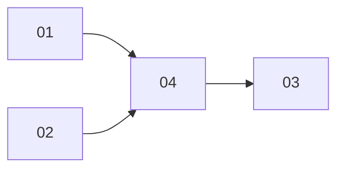

# Online polish: PRD index
Branch `feat/online-polish` (worktree `.worktrees/feat/online-polish`). All four sub-projects complete: 15/15 tasks, all final reviews PASS. No implementation tasks remain.

## Sub-projects
| NN | Title | Scope | Depends on | Phase | Status | PRD |
|---|---|---|---|---|---|---|
| 01 | Online match UX | Pause popup Leave (confirm -> forfeit) + Time left; rank-less aligned result table; online `hard` bot 700 -> 1000 ms | none | 1 (parallel with 02) | done (3/3); [PASS](01-online-match-ux/review-2026-11-03-0117.md) | [01-online-match-ux](01-online-match-ux/PRD.md) |
| 02 | Battle input | Pick radius 1.10 (+22 px floor); `R-ENT-05` min spacing 3.5 (hard error, 3 levels nudged); fading glow cut ribbon; Credits UI removal | none | 1 (parallel with 01) | done (4/4); [PASS](02-battle-input/review-2026-11-03-0124.md) | [02-battle-input](02-battle-input/PRD.md) |
| 04 | Version reset + legacy removal | All versions -> 1.0.0, tombstones/history/compat removed, `--base none` one-time gate baseline, regen locks/goldens | 01, 02 | 2 | done (4/4); [PASS](04-version-reset-legacy/review-2026-11-03-0226.md) | [04-version-reset-legacy](04-version-reset-legacy/PRD.md) |
| 03 | Docs restructure | iaudit-style `docs/` tree, ADRs, new concept/reference/testing docs, `check:docs` link + index checks | 01, 02, 04 | 3 | done (4/4); [PASS](03-docs-restructure/review-2026-11-03-0257.md) | [03-docs-restructure](03-docs-restructure/PRD.md) |

## Dependency graph

Execution order: 01 ∥ 02 -> 04 -> 03. Current state: 01 done (3/3 tasks), 02 done (4/4 tasks), 04 done (4/4 tasks; review PASS), 03 done (4/4 tasks; review PASS). 01 and 02 share only `apps/web/src/style.css` (disjoint blocks) and `App.tsx`.

## SP04 completion evidence

- [Code run and full verification](04-version-reset-legacy/code-2026-11-03-0224.md)
- [Three-persona review — PASS](04-version-reset-legacy/review-2026-11-03-0226.md)
- Source and regenerated artifacts complete through `68c76fb`; CI 44 gates, PvP 20/20 and campaign 20 levels passed. The one-time CI baseline override is restored only after the reset merges into main.

## SP03 completion and resume state

- [Code run and final verification](03-docs-restructure/code-2026-11-03-0257.md)
- [Three-persona review — PASS](03-docs-restructure/review-2026-11-03-0257.md)
- Task commits: `8ad7ba8`, `575cfc8`, `d5e028e`, `a823e4b`. Final CI: 44 gates, 1865 tests passed, 19 skipped; strict parked check empty. Maintained docs/path gates and source/frozen-byte audits passed.
- **Resume: none.** All 15 implementation tasks are done and reviewed. Deferred product ideas remain in the maintained futures list.

## Owner release follow-up

- Restore normal CI baseline selection only after this reset merges into main; keep the existing one-time override until then.
- Coordinate the Fly server drain/deploy, live health/version check and Firebase web release. No deployment is performed by this closure; final production friend play-test/M2 approval remains pending.

## Locked decisions (owner, 2026-11-03)
- Branch: SP01 and SP02 do normal version bumps per repo rules so each commit passes gates; SP04 then resets every version to 1.0.0.
- SP01: Leave in pause popup reuses existing `quit` (no protocol change); hard bot `actionDelayMs` 1000 accepted (retune after playtest); last-human-leaves FFA with bots stays [DEFERRED].
- SP02: min spacing is formal rule `R-ENT-05` (rule text + `covers R-ENT-05` test + RULES minor bump); violating saved custom levels = hard validation error, no migration/auto-nudge/compat; shipped violators (pos 8, 16, 20) nudged + relocked; pick margin +0.35 units; Credits UI removed, docs/tooling kept.
- SP03: `AGENTS.md`/`CLAUDE.md` path pointers + "Where docs go" table approved; new `check:docs` relative-link + folder-index checks approved; docs describe final state (all 1.0.0, no tombstones, single 1.0.0 changelog entry).
- SP04: `package.json` 0.0.0 -> 1.0.0; our own `editorVersion`/`gameVersion`-style product strings -> 1.0.0 (external/protocol codes like `CLOSE_VERSION=4003` and Tower War source metadata untouched); `DRAIN_MS=0` legacy shutdown removed; `*-v2` test files renamed; simHash/contentVersion handling decided by implementer, all goldens regenerated and match outcomes/ticks verified unchanged.

## Cross-cutting risks
- Shared files 01/02: `apps/web/src/style.css` (PvP block vs credits rules) and `apps/web/src/ui/App.tsx`. Keep edits in disjoint blocks; rebase whichever lands second; stage only own paths.
- Version gates: SP01/02 bumps (RULES 3.4.0, contentVersion, locks, goldens) must pass gates per commit; SP04 needs one-time `--base none` (`CONTENT_BASE=none` in ci.yml), then normal baseline restored only after the reset merges into main (owner follow-up).
- Golden regen in SP04 must show outcomes/ticks unchanged; header/hash-envelope diffs only.
- Deploy: protocol 4 -> 1 hard-refuses old clients (close 4003, reload UX). Fly server + web must deploy together, via drain deploy; room loss accepted.
- SP03 depends on SP02 having removed `Credits.tsx` (imports `docs/CREDITS.md?raw`); SP03 stops and flags if still present.
- Doc deltas documented by SP03: pause Leave, result table, `hard`=1000 ms, `R-ENT-05`/balance key, nudged levels.
- E2E churn: pause-forfeit and spectator-rematch specs (SP01), picker tests (SP02).

## Open questions for owner
- SP04 OPEN-6: `Supersedes:`/`Since:` removal makes `R-GRW`/`R-SPN` docs lose rationale; assumed acceptable. [RESOLVED: acceptable — owner chose full history wipe; rationale worth keeping captured as ADRs by SP03.]

## PR #45 final review
- [review-2026-11-03-PR45.md](review-2026-11-03-PR45.md) — whole-branch review, NEEDS_CHANGES -> fixed
