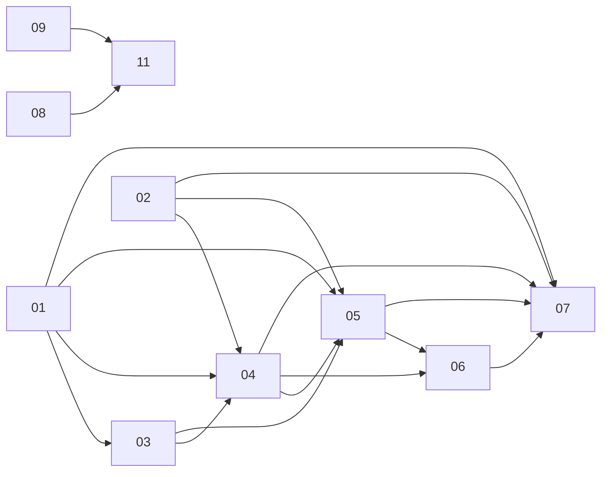

# Online PvP: PRD index

M1 merged in #39; owner local play-test passed (2026-10-29). M2 merged to main (#40, 993b796); M3 (SP08-SP11) implemented on `feat/pvp-m3` (acceptance map: [11-reconnect-polish/m3-acceptance-map.md](11-reconnect-polish/m3-acceptance-map.md); review: [review-2026-10-30-m3.md](review-2026-10-30-m3.md)); first Fly deployment and production acceptance remain pending. [M1 implementation and validation summary](code-2026-10-29-0300.md).

Live private-room PvP (2-4 seats, teams, bots, spectators) via deterministic lockstep + server referee sim on Fly.io. Full rationale, verified facts and decision log: [brainstorm.md](brainstorm.md). Milestones: M1 = 2-tab local 1v1 owner play-test; M2 = full lobby/teams/bots/spectators/rematch/maps/Fly deploy (minimal play-link startup included in M1); M3 = broader reconnect hardening, desync resync, load test. **M2 also includes [SP07 pause/Quit/window-close forfeit](07-pause-forfeit/PRD.md) (settled, approved) and its minimum reconnect/catch-up.**

## Sub-projects
| NN | Title | Phase | Depends on | M1 / M2 / M3 | PRD |
|---|---|---|---|---|---|
| 01 | Seat rules (teams, elimination, PvP outcome) | sim/defs/content rules | none | M1 core rules; M2 placement + bot ally filter; M3 - | [01-seat-rules](01-seat-rules/PRD.md) |
| 02 | Net protocol (`packages/net`) | shared pure package | 01 (types) | M1 catalogue, validation, lockstep, handshake; M2 catch-up, rate limits, batching; M3 auto-resync | [02-net-protocol](02-net-protocol/PRD.md) |
| 03 | PvP maps | content + level gates | 01 | M1 Duel S + symmetry gate + validate:levels pvp branch; M2 Duel M, Cross, listing, editor; M3 - | [03-pvp-maps](03-pvp-maps/PRD.md) |
| 04 | Game server (`apps/server`) | backend | 01, 02, 03 | M1 hub, room, clock, referee, hash check, end; M2 full lobby, bots, spectators, rematch, limits, Docker/fly.toml; M2 minimum SP07 reconnect; M3 broader reconnect/resync, load smoke | [04-game-server](04-game-server/PRD.md) |
| 05 | Web netplay (`apps/web`) | client | 01, 02, 03, 04 | M1 NetDriver, create/join, 2-seat lobby, result win/lose, desync toast; M2 full lobby, legend, catch-up, watch, rematch, deep links; M3 reconnect polish, resync | [05-web-netplay](05-web-netplay/PRD.md) |
| 06 | Deploy, CI, e2e | ops | 04, 05 (02 handshake) | M1 `dev:pvp`, 2-browser e2e, CI steps, doc stubs; M2 Fly deploy workflow, ordering, Docker job, more specs, runbook; M3 - | [06-deploy-e2e](06-deploy-e2e/PRD.md) |
| 07 | Pause, Quit and window-close forfeit | cross-cutting enhancement | 01, 02, 04, 05, 06 | M2 cumulative budget, confirmed Quit, deadline `Forfeit` command (RULES 3.2.0, PROTOCOL 2), heartbeat, minimum reconnect; all 13 tasks implemented | [07-pause-forfeit](07-pause-forfeit/PRD.md) |
| 08 | Desync auto-resync | net + server + web | 02, 04, 05, 07 | M3 | [08-desync-resync](08-desync-resync/PRD.md) |
| 09 | Drain-aware restart | server + web + deploy | 02, 04, 05, 07 | M3 | [09-drain-restart](09-drain-restart/PRD.md) |
| 10 | Load smoke | tooling + server healthz | none (independent) | M3 | [10-load-smoke](10-load-smoke/PRD.md) |
| 11 | Reconnect polish + protocol cleanup + M3 sweep | web + protocol | 08, 09 | M3 | [11-reconnect-polish](11-reconnect-polish/PRD.md) |

## Dependency graph

(M3: 08 and 09 depend on 02/04/05/07 and feed 11; 10 is independent.)
(01 also feeds 02 as types only; 03 feeds the 04 M1 gate and 05 map picker.)

## M1 critical path (historical; local owner play-test approved)
SP01#11 placement ranking was promoted from M2 and completed early to satisfy active R-WIN-07 coverage (47/47 rules). Pure derived result data leaves campaign behavior and PvP hashes unchanged. [Dependency review: PASS](01-seat-rules/review-2026-10-29-0238.md).

1. 01: `pvp` objective, teams/`SeatSetup`, hostility helper, elimination, victory + timeout/draw, `view.over`, hash tail, RULES_VERSION 3.1.0, goldens refreshed.
2. 02 (parallel with 03 after 01 types): catalogue, validators, `LockstepServer/Client`, `CommandLog`, handshake, `toWireOutcome`.
3. 03: Duel S + symmetry gate + pvp branch in `validate:levels` + `contentVersion` bump (Duel M/Cross are M2).
4. 04: hub/room/lobby for 2 seats, 20 Hz clock, referee, hash check, `end`, `/healthz`, loopback smoke.
5. 05: connection, per-tab identity, `NetDriver`, PvP menu/2-seat lobby/result, test hooks.
6. 06: `dev:pvp`, e2e harness, CI steps. Owner subsequently approved Duel S in two tabs (one profile is enough).

## Locked decisions (from brainstorm)
- Live real-time, private rooms by code/link, 2-4 seats (1v1, FFA, teams, bot fill), spectators (cap 8, read-only, no delay).
- Lockstep + server referee sim (hash is truth); input delay 3 ticks server-stamped; server-paced 20 Hz clock; clients never choose ticks.
- Plain `ws` + own protocol in `apps/server`; Fly.io single always-on machine, rooms in memory; web stays on Firebase Hosting.
- Identity: nickname + random token (no accounts; Firebase Auth later via `hello.auth`).
- M1 had no pause/speed. M2 (SP07, settled 2026-10-29): 30 s cumulative pause/disconnect budget per human, board + match clock freeze; Resume keeps unused time. Quit (confirmed) or budget expiry eliminates only that seat (buildings neutral, troops vanish, match continues; team wins if a teammate survives; 1v1 = opponent wins). Concurrent: manual Pause rejected while paused, a disconnect opens its own hold, resume when all holds end, first deadline forfeits, same-instant = draw if all remaining teams eliminated. Lobby: 30 s seat reserve then freed, host passes on, countdown drop cancels to lobby; budget only in match. No other human seated = unlimited pause (Quit still loses); bots never pause; spectators read-only. Old grace->bot plan dropped for humans. No auto-pause for a hidden tab.
- Elimination = no buildings and no troops in transit; last team standing wins; timeout ranks buildings then total troops owned; exact tie = draw (also when only the top teams of 3+ tie).
- Teams: allies never hurt each other and reinforce; ownership unchanged. Campaign outcomes unchanged; minor RULES_VERSION bump; goldens verify.
- Maps: Duel S, Duel M (2p), Cross (4p, default teams `[0,1,0,1]`); time limit per map only (default 480 s), no lobby override, no `SeatSetup.timeLimitTicks`.
- Sim player index == lobby seat index; team ids 0..n-1. `LockstepClient` only queues ticks; web owns the sim.
- Token in per-tab `sessionStorage`, nickname in localStorage `nodearena:pvp`.
- Lobby: host picks map and per-seat kind/difficulty/team; rematch = same room/setup, new seed.
- Deploy order: server first, then web; e2e duration measured at M1 (test-only fixture map if scripted Duel S > ~90 s).

## Cross-cutting risks
| Risk | Where | Mitigation |
|---|---|---|
| 1v1 snowball / draws common on symmetric maps | 01, 03 | M1 play-test; tune levels, centre level, time limit |
| Hidden nondeterminism in web path | 02, 04, 05 | Hash checkpoints every 20 ticks; server integration hash test; e2e equal final hash |
| 150 ms input delay feels laggy | 02, 05 | Configurable `INPUT_DELAY`; revisit prediction after M1 |
| Single Fly machine: deploys/restarts drop rooms | 04, 06 | Accepted for v1; M3 SIGTERM drain notice |
| Web/server version skew | 02, 06 | Handshake refusal + reload UX; server-first deploy; previews hit prod server |
| Runtime binds `sim.view` once (resync needs runtime recreation) | 05 | Recreate runtime on rebuild (M3) |
| Catch-up of 8 min match ~2.4 s CPU | 02, 05 | 8 ms/frame budget + overlay |
| Shared root `package.json` filter edits across 02/04/06 | 02, 04, 06 | First to land edits, others rebase |
| Golden/lock metadata churn (`rulesVersion`) collides with SP03 locks | 01, 03 | Land 01 first; regenerate locks after |
| Perf of `hostile()` in contact loops | 01 | Identity fast path; `bench:sim` gate |

## Owner-only manual steps
- Fly setup: owner-reported complete (account/billing/login, app creation and setup tasks, including deploy-token/repository configuration). Secret values were not inspected or verified. The owner reports the Fly dashboard has no deployment yet.
- First Fly deployment and live health/version verification remain pending. Dockerfile, Fly configuration, ordered deploy workflows and URL/origin wiring are implemented; Docker build/boot was not tested locally. Run the [operations checklist](../../../docs/PVP_OPS.md#first-deploy-checklist).
- Verify production and Firebase preview origins connect through wss and a disallowed origin is refused; run the Fly-edge heartbeat/disconnect timing check after first deploy. These live checks are unverified.
- M1 local human play-test: approved (2026-10-29). Full lobby, bots, teams, watch/rematch, pause/forfeit and minimum reconnect are implemented for M2.
- Production play-test with a friend, map tuning and final M2 approval remain pending. Rendering smoothing awaits play-test feedback.

## Version bumps and sequencing

Implemented identities (verified from source and content metadata):

| Constant | Current | Sequence / owner |
|---|---|---|
| `RULES_VERSION` | **3.2.0** | M1 3.1.0; SP07 added logged `Forfeit` with a minor bump |
| `contentVersion` | **2.6.0** | SP03 Duel M/Cross and content/lock updates landed after M1 |
| `BOT_VERSION` | **2.5.0** | SP01 ally filter, then SP04 bot presets/seats |
| `PROTOCOL_VERSION` | **2** | SP07 pause/resume/quit, pause state, forfeit and countdown-cancel messages |
| `SCHEMA_VERSION` | **2.0.0** | Unchanged; additive optional fields |

Historical integration sequence was 01 → (02 || 03) → 04 → 05 → 06, with SP07 threaded through rules → protocol → server → web → e2e. Each task's table remains the status authority.

## M2 amendment (settled 2026-10-29)
[SP07](07-pause-forfeit/PRD.md) is approved with all four owner policies resolved. Technical design: ws protocol heartbeat (3 s ping / 7 s timeout, silent-drop detection <= 8 s); `PROTOCOL_VERSION` 1 -> 2 (`pause`, `resume`, `quit`, `pause.state`, `seat.status` away/forfeit, errors `paused`/`no-match`); logged `Forfeit{player}` system command (`R-FFT-01..03`, `RULES_VERSION` 3.1.0 -> 3.2.0 minor); minimum reconnect (token reclaim, full catch-up, runtime recreation) promoted to M2; room removed from/re-added to the shared clock at `boundary(now())` on resume. SP01/02/04/05/06 carry dated amendment notes. **All 13 SP07 tasks are now done**, including two-browser verification and the deployed-heartbeat runbook; the live heartbeat check remains owner-pending. Order: rules text/version + replay design (SP01) -> protocol + heartbeat (SP02) -> server pause + reconnect + lobby (SP04) -> web controls + reconnect (SP05) -> e2e (SP06).

## Tasks

Current tracking-table totals: **95 done / 101 tasks** for SP01-07, plus **26 new M3 tasks** (SP08 5, SP09 8, SP10 6, SP11 7; all `todo`) = **95 done / 127 listed**. The six old M3 rows below are superseded and still listed but must not be counted as remaining work: real remaining = 26 (SP08-11). All **48 M1-labelled** and **47 M2-labelled** tasks are done; **six old M3** rows (SP02#13, SP04#19/#20, SP05#16/#17/#18) remain `todo` and are superseded by SP08-SP11. Counts preserve task milestone labels: SP01#11 remains labelled M2 even though placement ranking was promoted and completed for M1 coverage. 

| SP | TASKS | M1 | M2 | M3 | Total | Done |
|---|---|---|---|---|---|---|
| 01 | [01-seat-rules](01-seat-rules/TASKS.md) | 10 | 2 | 0 | 12 | 12 |
| 02 | [02-net-protocol](02-net-protocol/TASKS.md) | 9 | 3 | 1 | 13 | 12 |
| 03 | [03-pvp-maps](03-pvp-maps/TASKS.md) | 5 | 5 | 0 | 10 | 10 |
| 04 | [04-game-server](04-game-server/TASKS.md) | 9 | 9 | 2 | 20 | 18 |
| 05 | [05-web-netplay](05-web-netplay/TASKS.md) | 10 | 5 | 3 | 18 | 15 |
| 06 | [06-deploy-e2e](06-deploy-e2e/TASKS.md) | 5 | 10 | 0 | 15 | 15 |
| 07 | [07-pause-forfeit](07-pause-forfeit/TASKS.md) | 0 | 13 | 0 | 13 | 13 |
| 08 | [08-desync-resync](08-desync-resync/TASKS.md) | 0 | 0 | 5 | 5 | 0 |
| 09 | [09-drain-restart](09-drain-restart/TASKS.md) | 0 | 0 | 8 | 8 | 0 |
| 10 | [10-load-smoke](10-load-smoke/TASKS.md) | 0 | 0 | 6 | 6 | 0 |
| 11 | [11-reconnect-polish](11-reconnect-polish/TASKS.md) | 0 | 0 | 7 | 7 | 0 |
| | **Total (SP01-07)** | 48 | 47 | 6 (superseded, see M3 plan) | 101 | **95** |
| | **New M3 (SP08-11)** | 0 | 0 | 26 | 26 | **0** |
| | **Total (SP01-11)** | 48 | 47 | 32 listed (6 superseded + 26 live) | 127 | **95 done / 127 tasks; live remaining 26** |

### M1 execution order (historical; complete)
Topological waves; `||` = independent, run at most 2 at a time (parallelism cap).
1. `SP01#1 || SP02#1` (SP05#2 also ready, no deps; slot it in when a lane frees)
2. `SP01#2 || SP02#2` ; then `SP02#5`, `SP04#1`, `SP05#1`
3. `SP01#3 || SP01#4` ; `SP02#3`, `SP02#7`, `SP04#3`
4. `SP01#5`, `SP01#6`, `SP01#7` (all after #4) ; `SP02#4`, `SP02#6` ; `SP03#1`, `SP04#2`, `SP05#4`
5. `SP01#8` ; `SP03#2` ; `SP04#4` ; `SP05#3`
6. `SP01#9` ; `SP02#8` ; `SP03#3` ; `SP04#5`
7. `SP01#10` ; `SP02#9` ; `SP03#4` ; `SP04#6` ; `SP05#5`
8. `SP03#5` ; `SP04#7` ; `SP04#9` ; `SP05#6`
9. `SP04#8` ; `SP05#7` ; `SP06#1`
10. Tail, serial: `SP05#8 → SP05#9 → SP05#10 → SP06#2 → SP06#3 → SP06#4 → SP06#5` (M1 owner play-test)

Pair within a wave only when files do not conflict (e.g. SP01 sim tasks vs SP02/SP04 packages are safe; SP01#5/#6/#7 all touch sim, run serially or in 2 lanes with care; root `package.json` edits in SP02#1/SP04#1/SP06#1 conflict, keep them serial).

### M2 completed scope and actual integration order

| SP | Completed M2-labelled tasks | Result |
|---|---|---|
| 01 | #11–12 | Placement ranking (promoted/completed in M1), bot ally filter |
| 02 | #10–12 | Catch-up, rate limiter, lagging-client batching |
| 03 | #6–10 | Duel M, Cross, map listing and PvP editor/finalize |
| 04 | #10–18 | Bots/full lobby, spectators, host transfer/rematch, abuse limits, health/drain, Docker/Fly config, lobby scenarios |
| 05 | #11–15 | Full lobby, team legend/bar, catch-up overlay, watch/deep links, N-seat results/rematch |
| 06 | #6–15 | Deploy/order/URL/origins, Docker job, mismatch, spectator/rematch, bot/Cross e2e, docs/runbook |
| 07 | #1–13 | Rules/Forfeit → protocol → heartbeat/pause/deadlines → lobby/reclaim → web controls/recreation → two-browser e2e/runbook |

Implemented in interleaved dependency lanes: pure bot/map/catch-up foundations; rules/protocol; server lobby/spectator/rematch and pause/forfeit; maps/web controls and minimum reconnect; bot seats/ops/editor/deploy; browser verification and docs. SP07's task order is #1 → #2 → #3 → #4/#5 → #6 → #7/#8 → #9 → #10/#11/#12 → #13 (actual server/web integration was interleaved with the other SPs).

The branch already held **49 commits ahead of main through `d364c83`**, including SP07#13 and SP06 spectator/rematch. Resumed tail, now done: **SP06#11** (`62da259`, mismatch) → **SP06#13** (`274d3ce`, bot/Cross) → **SP06#14** (`3e47dd9`, docs). Final gate repairs: metadata-only golden refresh `0f00b6a` (simulation values/hashes unchanged), replay count `373a998`, FFT coverage count `d67e0ba`, and editor objective expectation `2b2f671`; production behavior unchanged by these repairs. [Resumed-delta review: PASS](06-deploy-e2e/review-2026-10-29-1754.md). [Final run summary](code-2026-10-29-1754.md): local CI **44 stages / 1570 passed**, full PvP **13 passed**; original full-web run had one stale assertion, then the affected spec passed **2/2** after repair (136 other executed web cases passed; no monolithic full-web exit-0 claim).

### M3 backlog (superseded 2026-10-30)

Old rows SP02#13, SP04#19 (void, already superseded by SP07), SP04#20, SP05#16, SP05#17, SP05#18 are superseded by SP08-SP11; their Status values are unchanged and each now carries a pointer line. Replacement task tables: SP08-SP11 TASKS.md (26 tasks, listed above; the six superseded rows are not double counted as remaining).

## M3 plan
Scope: [SP08](08-desync-resync/PRD.md) desync auto-resync; [SP09](09-drain-restart/PRD.md) SIGTERM drain/abort notice; [SP10](10-load-smoke/PRD.md) report-only load smoke; [SP11](11-reconnect-polish/PRD.md) reconnect UX, protocol cleanup, M3 acceptance sweep.

Locked decisions:
- One shared `PROTOCOL_VERSION` 2 -> 3 bump for the whole milestone.
- Land order SP08 -> SP09 -> SP11; SP10 independent.
- Drain = abort with no result (no rules change).
- Resync limit 1 per 10 s per seat/spectator; also spends `allowCatchUp` (1/5 s per player, 20/min per IP).
- Net `createCatchup` is a test oracle only.
- Already delivered in M2 fixes (dde99c1, 1a93075, 8528f00): hash suppression during catch-up, `onRoomClosed` hook, reconnect attempt reset (STABLE_MS), host-pass ready clear.

Owner-only steps: first Fly deploy verification (`kill_timeout` >= 40 s allowed, no new-connection routing during stop, drain rehearsal on a live match); Fly load run and `MAX_ROOMS`/VM decision; deploy-timing preference. Tagged `[DEFERRED: owner verifies at first deploy]` in SP09/SP10.

Orchestrator defaults (owner may override): see `[RESOLVED: orchestrator default]` tags in SP08-SP11.

## M2 post-merge review
M2 merged to main as #40 (993b796). Review: [review-2026-10-30-1617.md](review-2026-10-30-1617.md) (NEEDS_CHANGES, 5 must-fix). Fix commits: a0a63c4 (buffers, conn rate, catch-up limiter, ping cleanup), dde99c1 (room lifecycle), 1a93075 (feed flush, duplicate limiter, onRoomClosed), 8528f00 (web leave, 4005 backoff, stable reset, hash suppression).

