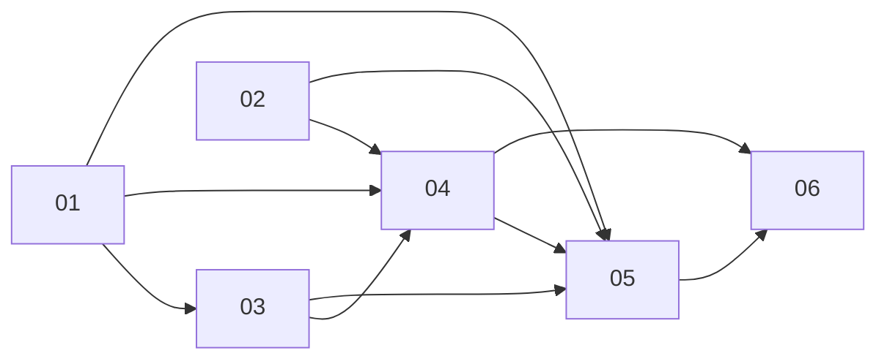

# Online PvP: PRD index

Live private-room PvP (2-4 seats, teams, bots, spectators) via deterministic lockstep + server referee sim on Fly.io. Full rationale, verified facts and decision log: [brainstorm.md](brainstorm.md). Milestones: M1 = 2-tab local 1v1 owner play-test; M2 = lobby/teams/bots/spectators/rematch/maps/Fly deploy; M3 = reconnect hardening, desync resync, load test.

## Sub-projects
| NN | Title | Phase | Depends on | M1 / M2 / M3 | PRD |
|---|---|---|---|---|---|
| 01 | Seat rules (teams, elimination, PvP outcome) | sim/defs/content rules | none | M1 core rules; M2 placement + bot ally filter; M3 - | [01-seat-rules](01-seat-rules/PRD.md) |
| 02 | Net protocol (`packages/net`) | shared pure package | 01 (types) | M1 catalogue, validation, lockstep, handshake; M2 catch-up, rate limits, batching; M3 auto-resync | [02-net-protocol](02-net-protocol/PRD.md) |
| 03 | PvP maps | content + level gates | 01 | M1 Duel S + symmetry gate + validate:levels pvp branch; M2 Duel M, Cross, listing, editor; M3 - | [03-pvp-maps](03-pvp-maps/PRD.md) |
| 04 | Game server (`apps/server`) | backend | 01, 02, 03 | M1 hub, room, clock, referee, hash check, end; M2 full lobby, bots, spectators, rematch, limits, Docker/fly.toml; M3 grace/reconnect/reclaim, resync, load smoke | [04-game-server](04-game-server/PRD.md) |
| 05 | Web netplay (`apps/web`) | client | 01, 02, 03, 04 | M1 NetDriver, create/join, 2-seat lobby, result win/lose, desync toast; M2 full lobby, legend, catch-up, watch, rematch, deep links; M3 reconnect polish, resync | [05-web-netplay](05-web-netplay/PRD.md) |
| 06 | Deploy, CI, e2e | ops | 04, 05 (02 handshake) | M1 `dev:pvp`, 2-browser e2e, CI steps, doc stubs; M2 Fly deploy workflow, ordering, Docker job, more specs, runbook; M3 - | [06-deploy-e2e](06-deploy-e2e/PRD.md) |

## Dependency graph

(01 also feeds 02 as types only; 03 feeds the 04 M1 gate and 05 map picker.)

## M1 critical path (2-tab play-test)
1. 01: `pvp` objective, teams/`SeatSetup`, hostility helper, elimination, victory + timeout/draw, `view.over`, hash tail, RULES_VERSION 3.1.0, goldens refreshed.
2. 02 (parallel with 03 after 01 types): catalogue, validators, `LockstepServer/Client`, `CommandLog`, handshake, `toWireOutcome`.
3. 03: Duel S + symmetry gate + pvp branch in `validate:levels` + `contentVersion` bump (Duel M/Cross are M2).
4. 04: hub/room/lobby for 2 seats, 20 Hz clock, referee, hash check, `end`, `/healthz`, loopback smoke.
5. 05: connection, per-tab identity, `NetDriver`, PvP menu/2-seat lobby/result, test hooks.
6. 06: `dev:pvp`, e2e harness, CI steps. Owner then plays Duel S in two tabs (one profile is enough).

## Locked decisions (from brainstorm)
- Live real-time, private rooms by code/link, 2-4 seats (1v1, FFA, teams, bot fill), spectators (cap 8, read-only, no delay).
- Lockstep + server referee sim (hash is truth); input delay 3 ticks server-stamped; server-paced 20 Hz clock; clients never choose ticks.
- Plain `ws` + own protocol in `apps/server`; Fly.io single always-on machine, rooms in memory; web stays on Firebase Hosting.
- Identity: nickname + random token (no accounts; Firebase Auth later via `hello.auth`).
- No pause/speed in PvP; disconnect -> 30 s grace -> AI bot takes seat; reconnect by log replay.
- Elimination = no buildings and no troops in transit; last team standing wins; timeout ranks buildings then total troops owned; exact tie = draw (also when only the top teams of 3+ tie).
- Teams: allies never hurt each other and reinforce; ownership unchanged. Campaign outcomes unchanged; minor RULES_VERSION bump; goldens verify.
- Maps: Duel S, Duel M (2p), Cross (4p, default teams `[0,1,0,1]`); time limit per map only (default 480 s), no lobby override, no `SeatSetup.timeLimitTicks`.
- Sim player index == lobby seat index; team ids 0..n-1. `LockstepClient` only queues ticks; web owns the sim.
- Token in per-tab `sessionStorage`, nickname in localStorage `nodearena:pvp`.
- Lobby: host picks map and per-seat kind/difficulty/team; rematch = same room/setup, new seed.
- Deploy order: server first, then web; e2e duration measured at M1 (test-only fixture map if scripted Duel S > ~90 s).

## Cross-cutting risks
| Risk | Where | Mitigation |
|---|---|---|
| 1v1 snowball / draws common on symmetric maps | 01, 03 | M1 play-test; tune levels, centre level, time limit |
| Hidden nondeterminism in web path | 02, 04, 05 | Hash checkpoints every 20 ticks; server integration hash test; e2e equal final hash |
| 150 ms input delay feels laggy | 02, 05 | Configurable `INPUT_DELAY`; revisit prediction after M1 |
| Single Fly machine: deploys/restarts drop rooms | 04, 06 | Accepted for v1; M3 SIGTERM drain notice |
| Web/server version skew | 02, 06 | Handshake refusal + reload UX; server-first deploy; previews hit prod server |
| Runtime binds `sim.view` once (resync needs runtime recreation) | 05 | Recreate runtime on rebuild (M3) |
| Catch-up of 8 min match ~2.4 s CPU | 02, 05 | 8 ms/frame budget + overlay |
| Shared root `package.json` filter edits across 02/04/06 | 02, 04, 06 | First to land edits, others rebase |
| Golden/lock metadata churn (`rulesVersion`) collides with SP03 locks | 01, 03 | Land 01 first; regenerate locks after |
| Perf of `hostile()` in contact loops | 01 | Identity fast path; `bench:sim` gate |

## Owner-only manual steps
1. Create Fly account + billing; `fly auth login`.
2. Create Fly app `node-arena-server` (`fly apps create node-arena-server`; `fly scale count 1`); confirm name/region (`ewr`).
3. Create app-scoped deploy token (`fly tokens create deploy -a node-arena-server`) and add as GitHub secret `FLY_API_TOKEN`.
4. Add GitHub repo variable `PVP_SERVER_URL=wss://node-arena-server.fly.dev`.
5. Run first server deploy; confirm `/healthz`.
6. Play-tests: M1 (Duel S, two tabs), later prod with a friend; map tuning decisions; final approval.

## Version bumps and sequencing
| Constant | Change | Owner | Notes |
|---|---|---|---|
| `RULES_VERSION` | 3.0.0 -> 3.1.0 (minor) | 01 | Only SP01 touches it. Goldens/replays/`levels-lock`/`content.json` change `rulesVersion` metadata only. |
| `contentVersion` | 2.3.4 -> 2.4.0 (minor) | 03 | SP01 also edits content schemas/compile and `content.json` rulesVersion; if `check:content` demands a content bump for SP01, do it in SP01 and have SP03 bump relative to the result (conflict: same constant, two SPs). Sequence 01 then 03; regenerate `content:lock` and `levels:lock` after 03 on top of 01. |
| `BOT_VERSION` | 2.4.5 -> 2.5.0 (minor) | 04 | SP01 already landed 2.4.5 (ally filter). Possible conflict:  SP03 may need a bump if `check:content` demands. Sequence 01 -> 03 -> 04 so SP04 lands 2.5.0 last; any earlier patch is subsumed. Regenerate bot goldens only if identity map changes. |
| `PROTOCOL_VERSION` | new, int | 02 | Bumped on any wire break after first ship. |
| `SCHEMA_VERSION` | stays 2.0.0 | 01 | Additive optional fields; bumping breaks replay headers. |
Recommended merge order: 01 -> (02 || 03) -> 04 -> 05 -> 06; each locks/regenerates after rebasing on the previous.

## Tasks
Per-SP task breakdowns (all Status `todo`). Cross-SP deps use `SPxx#N`; no cycles, no M1 task depends on M2/M3 (verified by script).

| SP | TASKS | M1 | M2 | M3 | Total |
|---|---|---|---|---|---|
| 01 | [01-seat-rules](01-seat-rules/TASKS.md) | 10 | 2 | 0 | 12 |
| 02 | [02-net-protocol](02-net-protocol/TASKS.md) | 9 | 3 | 1 | 13 |
| 03 | [03-pvp-maps](03-pvp-maps/TASKS.md) | 5 | 5 | 0 | 10 |
| 04 | [04-game-server](04-game-server/TASKS.md) | 9 | 9 | 2 | 20 |
| 05 | [05-web-netplay](05-web-netplay/TASKS.md) | 10 | 5 | 3 | 18 |
| 06 | [06-deploy-e2e](06-deploy-e2e/TASKS.md) | 5 | 10 | 0 | 15 |
| | **Total** | **48** | **34** | **6** | **88** |

### M1 execution order
Topological waves; `||` = independent, run at most 2 at a time (parallelism cap).
1. `SP01#1 || SP02#1` (SP05#2 also ready, no deps; slot it in when a lane frees)
2. `SP01#2 || SP02#2` ; then `SP02#5`, `SP04#1`, `SP05#1`
3. `SP01#3 || SP01#4` ; `SP02#3`, `SP02#7`, `SP04#3`
4. `SP01#5`, `SP01#6`, `SP01#7` (all after #4) ; `SP02#4`, `SP02#6` ; `SP03#1`, `SP04#2`, `SP05#4`
5. `SP01#8` ; `SP03#2` ; `SP04#4` ; `SP05#3`
6. `SP01#9` ; `SP02#8` ; `SP03#3` ; `SP04#5`
7. `SP01#10` ; `SP02#9` ; `SP03#4` ; `SP04#6` ; `SP05#5`
8. `SP03#5` ; `SP04#7` ; `SP04#9` ; `SP05#6`
9. `SP04#8` ; `SP05#7` ; `SP06#1`
10. Tail, serial: `SP05#8 → SP05#9 → SP05#10 → SP06#2 → SP06#3 → SP06#4 → SP06#5` (M1 owner play-test)

Pair within a wave only when files do not conflict (e.g. SP01 sim tasks vs SP02/SP04 packages are safe; SP01#5/#6/#7 all touch sim, run serially or in 2 lanes with care; root `package.json` edits in SP02#1/SP04#1/SP06#1 conflict, keep them serial).

### M2 headline order
SP02#10 → SP01#11, SP01#12, SP03#8 → SP04#11 → SP04#10, SP04#13, SP03#9, SP03#10 → SP04#12, SP04#14, SP04#15, SP02#11, SP02#12, SP05#13 → SP03#6, SP03#7, SP04#16, SP05#11, SP05#14 → SP04#17, SP04#18, SP05#12 → SP05#15, SP06#6, SP06#9 → SP06#7 → SP06#8 → SP06#10..#13, SP06#15 → SP06#14.

### M3 headline order
SP02#13 → SP04#19 → SP04#20 → SP05#17 → SP05#16 → SP05#18.
