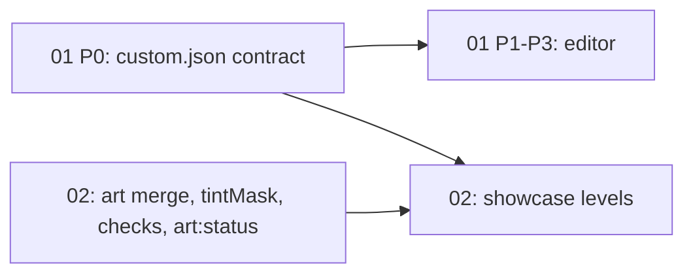

# Level editor + art overrides

## Goal
Two approved dev-only tools: in-app level editor and art-override layer. P0 custom-list contract (01-level-editor Tasks 1–2) is complete and reviewed; editor Tasks 3–12 and art implementation remain pending.

## Contents
| File | Purpose | Status |
|---|---|---|
| [brainstorm.md](brainstorm.md) | Decision log + design brief for both projects | approved |
| [01-level-editor/PRD.md](01-level-editor/PRD.md) | Dev-only editor.html, `/__editor/*` middleware, Play/Solvable?/Finalize, custom-level list | approved |
| [01-level-editor/TASKS.md](01-level-editor/TASKS.md) | P0 Tasks 1–2 done; Tasks 3–12 pending | in-progress |
| [02-art-overrides/PRD.md](02-art-overrides/PRD.md) | `assets/art/` override layer, tintMask, relaxed credits check, `art:status`, showcase levels | approved |
| [02-art-overrides/TASKS.md](02-art-overrides/TASKS.md) | Approved implementation tasks; implementation deferred | approved |
| [01-level-editor/code-2026-10-24-0627.md](01-level-editor/code-2026-10-24-0627.md) | P0 implementation, verification and cleanup record | done |
| [01-level-editor/review-2026-10-24-0627.md](01-level-editor/review-2026-10-24-0627.md) | Three-persona P0 review: PASS, zero outstanding must-fix | done |

## Sub-projects
| # | Name | Scope | Depends on | Phase |
|---|---|---|---|---|
| 01 | Level editor | editor.html + dev middleware + custom list + Finalize | none | P0 done; P1 viewer+save, P2 editing, P3 play/solvable/finalize pending |
| 02 | Art overrides | art folder/manifest merge, tintMask, checks, `art:status`, 2 showcase levels | 01 P0 (custom-list contract) for showcase levels only; rest independent, parallel | single PRD, no phases defined |

## Dependency graph

## Locked decisions
See [brainstorm.md decision log](brainstorm.md#decision-log); not duplicated.
- Own editor in `apps/web/editor.html`, Vite dev middleware for fs, dev-only (level editor table).
- v1 = layout + player/AI settings + in-editor Play; Solvable? and Finalize are separate buttons.
- Tools never `git commit`; owner commits.
- Custom levels in separate list (`campaigns/custom.json`), below the 20, always unlocked.
- Art lives in `apps/web/assets/art/`, ignored by importer/lock; `manifest.art.json` merged after TW fragment (art overrides table).
- Field-level overrides, replace existing visuals only; stale override target fails loudly.
- Team colour: 5-skin swap or 1-skin + tintMask.
- CREDITS.md check becomes warning; game-compat checks (budgets, stage nodes) stay.
- No preview page: two showcase levels (green, snow) instead; reload to see changes.

## Shared seams
- `custom.json` / custom-list contract (01 R6, 01 P0)
- `campaignLevels()` stays Common-only; `customLevels()` supplies custom entries; union selection/integrity checks cover both
- `hashes.lock.json` + `contentVersion` + `BOT_VERSION`
- `levels-lock.json`
- `tools/unsolved-by-proxy.json`
- 20-level test exclusions (tests selecting levels must not sweep custom)
- `tools/README.md` (document new commands/gates)

## Cross-cutting Open Questions
a) [RESOLVED: yes, covered — 01 P0] Do `validate:levels` / `levels:lock` cover custom `na-*` levels? P0 now selects Common + custom while preserving the Common-only `campaignLevels(data)` helper.
b) [RESOLVED: position optional — 01 P0] P0 accepts custom entries without `position`; Common entries retain their positions (shared 01/02).
c) [RESOLVED] `BOT_VERSION` bump required for new levels with AI seats (CONTENT_GUIDE). 01 R5 wording updated.
d) All PRD open questions resolved/deferred (2026-10-24).

## Next step
P0 Tasks 1–2 are complete with a PASS review. Publish this scoped branch for owner review; remaining level-editor tasks and art-overrides implementation stay deferred. Approved PRDs are preserved; task tables track remaining work.
