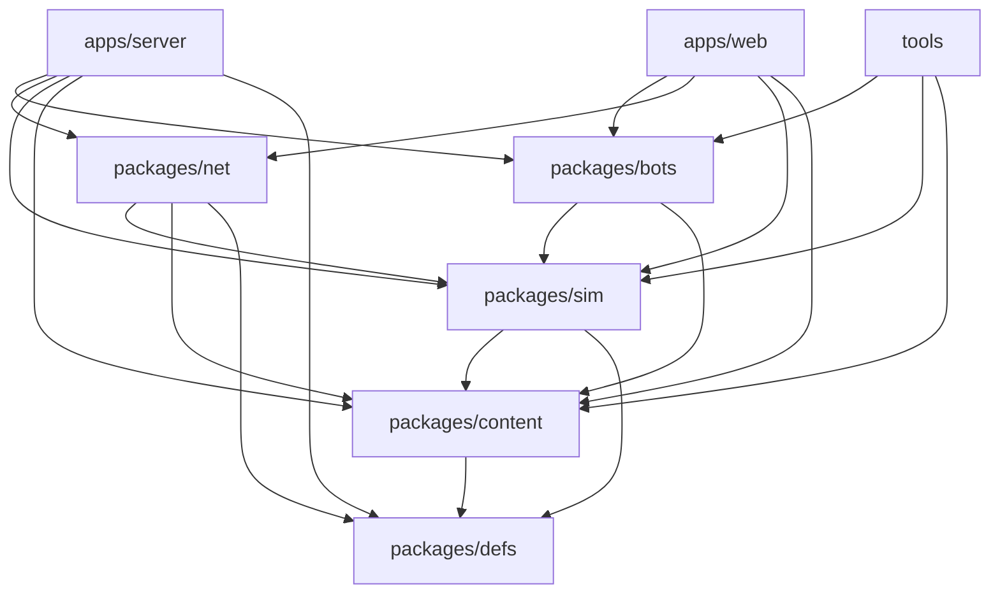
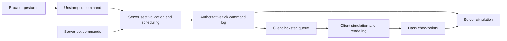

# Architecture

Node Arena is a pnpm monorepo with a shared deterministic simulation, browser client and authoritative WebSocket server. [Mission](mission.md) defines product scope; [game rules](specs/game-rules.md) define mechanics.

## Workspace dependencies

Arrows point from a consumer to its direct workspace dependencies. Third-party libraries are omitted; the workspace package manifests are the source of this diagram.

| Workspace | Responsibility and source |
|---|---|
| defs | Pure module, command, event, objective and bot registries; [registry entrypoint](../packages/defs/src/index.ts) |
| content | Schemas, validation, fixed-point conversion, compilation and identity hashes; [loader](../packages/content/src/content.ts) |
| sim | Integer state transitions, commands, queries, hashes and replay; [public API](../packages/sim/src/index.ts) |
| bots | Seeded seat controllers and difficulty presets; [public API](../packages/bots/src/index.ts) |
| net | Transport-free message validation, version handshake, command log and lockstep queues; [public API](../packages/net/src/index.ts) |
| server | Node + ws connections, room lifecycle, shared clock, referee simulation and server-run bots; [match controller](../apps/server/src/match.ts) |
| web | Vite + Preact shell, Three.js world, gestures, local progress and network driver; [runtime](../apps/web/src/app/runtime.ts) |
| tools | Content/art import, authoring support and validation gates; [inventory](../tools/README.md) |

Definitions never import the engine. Content stays browser-safe; filesystem/git access belongs to scripts, tools and server boundaries. Rendering and wall-clock scheduling stay outside simulation outcomes.

## Campaign data flow

[Browser boot](../apps/web/src/app/boot.ts) loads authored JSON into the content loader/compiler. The chosen compiled level and match seed create the local simulation and bot driver. [GameDriver](../apps/web/src/driver/index.ts) merges player and bot commands for each fixed step; views and events feed rendering, HUD and audio. Result handling records local campaign completion through the [save store](../apps/web/src/save/index.ts).

## Online data flow

The server loads the same compiled content, chooses the seed and seat/team setup, and owns tick scheduling. Clients run the shared simulation from server tick batches; they send command intents without player IDs or chosen ticks. Server-side bots contribute commands to that same log. Hash checkpoints detect disagreement; reconnect and resync rebuild from match start and the retained log. See [match lifecycle](concepts/pvp-match-lifecycle.md).

The static client is hosted on Firebase; one Fly machine holds rooms in memory. Drain/restart ends those rooms. For server-affecting changes, server deploy and version health checks precede web deployment; operational details belong to the [runbook](operations/pvp-server.md).
